# TShock从零开始的使用教学 - 上

**原作者：棱镜，搬运更新：肝帝熙恩**

## 前言的前言：

突然发现棱镜的教程都已经有点过时了，不得不感叹时间过得真快  
当年我也是仔细看过这篇教程，也受益良多  
由于旧论坛即将关闭（2024年5月4日）（已经复活但是和死了差不多），我决定将棱镜的教程搬运过来并且更新  
当然 ，大部分内容还是保留了棱镜的，我只改了TS新版本有比较大变化，或者原贴讲的不够清楚的地方

## 前言：

鉴于目前TR圈内大多数TShock教学都已经过气<s>（包括本贴）（确信）</s>（现在不是了！以后TS更新这个也会尽快更新）  
而且目前网上存在的各类教学质量良莠不齐  
所以棱镜打算抽出点时间来<s>制作</s>重制一个从零开始的TShock使用教学  
虽然本教程使用的是云服务器作为示范，但是绝大部分内容适用于多平台，无论你在哪个平台使用TShock，都适宜观看本教程，其他有针对性质的内容（如面板服的面板配置选择和使用），可去对应的平台观看他们针对性的相关内容  
<u>*本帖主要以技术普及为主，语言可能会比较<s>沙雕通俗</s>，如果有错误请dalao及时指出*</u>

## 需要准备些什么？

- 一台可以联网的电脑（可以是自己电脑，简幻欢等面板，云服务器等等）（如果你愿意折腾，手机什么的也可以，但是本贴不示范其他设备开服）
- 建议使用Win10以上系统（<s>但是我是win2012R2</s>），Linux或macos也可以，但是强烈不推荐mac，对新手适中推荐Linux，最推荐Win，但是win的系统占用远高于Linux，请根据实际情况进行选择
- 安装好的TShock<strong>（下方详细解释）</strong>
- 有一定英语&编程基础的玩家在学习时会更加轻松
- 一定得有的基础：计算机文件目录的基本认识、文件类型的基础了解（这个不懂的请赶紧去补补）

## 注意事项：

本教学使用的部分教学资源将来自tshock英文官网  
所以可能会大量出现英语内容（这也是为什么要强调有英语基础的会学得更轻松的原因）（现在汉化很多对英语要求降低了）

**※本教学主要以教授TShock的使用为主，想要学习实际开服技术的可以在网上搜索其他教学**

## Pt.0-1：下载解压安装TShock说明

首先进入github，搜索tshock，或者[点击本处链接](https://github.com/Pryaxis/TShock)  
如果你进不去，说明你可能需要 [steam++](https://steampp.net/)  
点击[Releases](https://github.com/Pryaxis/TShock/releases)

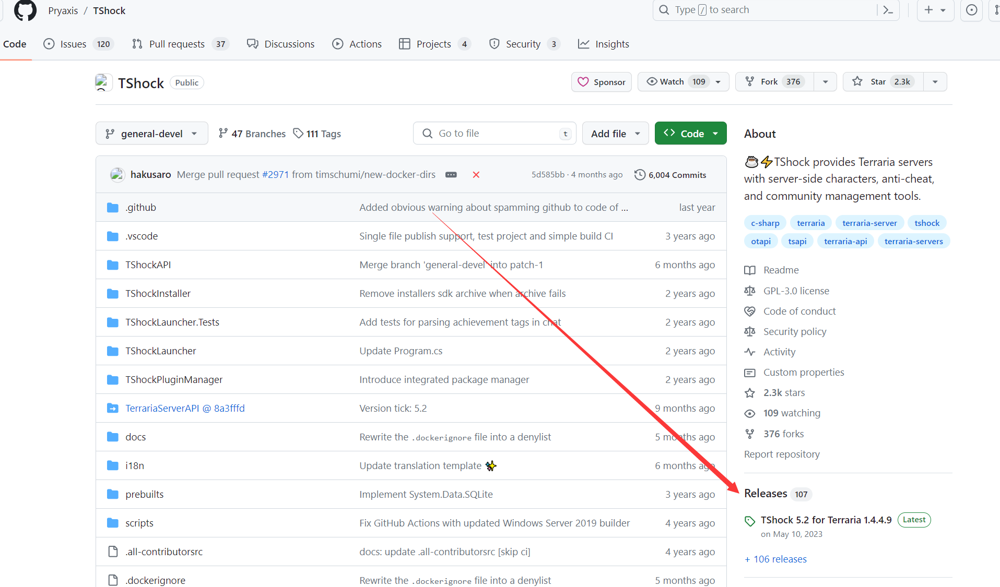

根据自己的系统版本下载链接中的TShock，直接解压至自己知道的目录即可

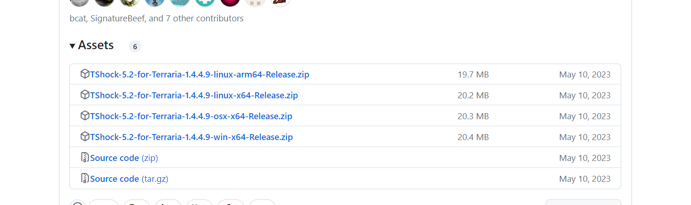

我这里以win为例子(其他版本差别不会很大，如果你是面板服，一般他会帮你下载好，如果没有你也可以本地下载后上传)  
**注：请务必保留安装包下的最外层目录，防止引起混乱**  
现在你安装完毕的TShock应该是这个样子...

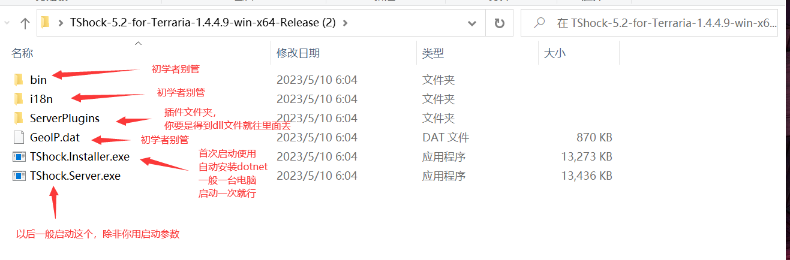

## Pt.1-1.初次运行你的服务器

### 前置知识预习：

**指令：在TShock中表现为由指令前缀符号（如：/和 .）引导的具有特殊效果的语句**  
例如`/help`会返回tshock的指令列表  
一条指令的基本特征：有一个名称（例如help），需要一个特定权限（有些也是不需要的），能够产生特定效果  
**超级管理员：TShock系统中象征最高权限的用户组（也是后面会讲到的内容）**  
**用户：指TShock系统中为玩家创建的信息体**  
例如：玩家名称，密码，UUID等，在SSC模式下也包括玩家的角色数据（背包内容，生命魔力等）  
说白了就是玩家在服务器中的<strong>账号</strong>  
**组：指TShock系统中的用户组，用户组中的元素为用户，这些用户具有该组规定的特殊信息(权限以及花里胡哨的东西)**  
打个通俗的比方，你学校里是不是有班干部班委之类的？  
所有人类都是一个用户（<s>好吧，蟑螂也是</s>）  
普通学生就像tshock里的default（默认）用户组，有可以在班上生活的权限  
班委按照地位：（课代表）就像tshock里的admin（管理员），班长就像tshock里的owner（服主）用户组，不仅有可以在班上生活，还具有一定对其他学生的管理权力  
老师很明显就是superadmin（超级管理员），掌握所有人的生杀大权

### 启动服务器：

在启动服务器之前，我要先教你如何汉化tshock的基本功能（特别致谢各位出色的汉化组成员）  
我推荐两种方法：  
1.使用插件，我推荐<strong>[yaaiomni](https://github.com/sgkoishi/yaaiomni)，也就是俗称恋恋<s>的乱七八糟</s>的插件，它提供了非常多的功能，强烈推荐所有服主安装</strong>  
什么，你还不会下载插件？我再教一遍，你<strong>以后接触到的插件或工具很多都是在github上以这种方式进行下载</strong>，记好喽  
点击上方链接后

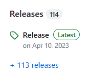

点Release

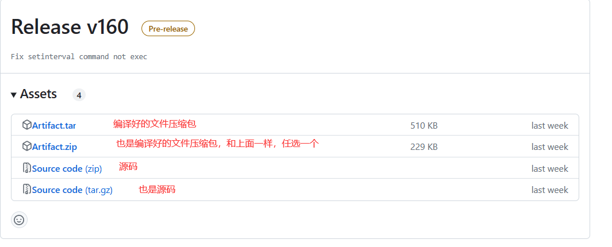

下载最上面两个任意一个压缩包，另外两个压缩包是提供给开发着的源码，一般服主用不上，<strong>下载后将压缩包里面两个.dll文件复制进ServerPlugins（[详细可看Pt.2-4.TShock插件的使用](./TShockTutorial2.md)），</strong>安装后启动ts，会根据系统语言自动汉化（所以如果系统语言不是中文用此方法会失败）  
2.使用启动参数，可以参考[**Pt.3-2.TShock启动命令行参数**](./TShockTutorial2.md#pt-3-2-tshock启动命令行参数)或[hufang大佬的教程](https://b23.tv/G46UlIL?share_medium=android&share_source=qq&bbid=XY597465E1ECEBCA698FAA2ACB0741D91222C&ts=1708243249934)，hufang也是一名出色的开发者，有关tshock的相关内容也可以多去他那里查看

现在，打开你的TShock文件夹  
如果你的这台电脑从来没有运行过tshock，那么你运行TShock.Installer.exe，如果这个太慢了，你也可以选择手动安装环境，tshock需要.net6的环境:

- [.net 6（点这个是直接下载）](https://dotnet.microsoft.com/zh-cn/download/dotnet/thank-you/runtime-desktop-6.0.13-windows-x64-installer)

  - [通道二(我的网盘分享的)](https://www.123pan.com/s/x6kKVv-yjhe)
  - [官网（点这个是到官网链接）](https://dotnet.microsoft.com/zh-cn/download/dotnet/6.0)

什么，下载后怎么安装？我只能说安装的时候上面提示都是中文的

如果你电脑成功运行过tshock，哪怕只有一次，那么你就可以直接运行TShock.Server.exe或你的启动文件  
什么？你看不到.exe这个后缀？  
请单击文件夹上方的查看，勾选“文件扩展名”（仅限Win10）

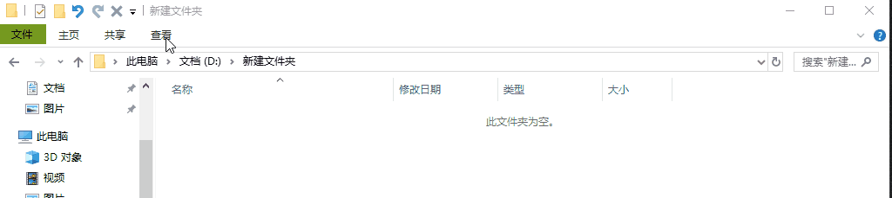

Win10以下版本请自行寻找教学，<s>棱镜懒得跟你讲了</s>  
虽然要善用搜索引擎，但是这里棱镜还是手动帮你查到了教学，戳下面链接吧~  
[Win7开启文件后缀名显示](http://xinzhi.wenda.so.com/a/1520313228205327)  
Win10的看上面Gif  
运行之后你可以看到一个黑色窗口，这个窗口我们称之为TShock的<strong>后台</strong>

::: details 【技术细节】关于后台
在TShockAPI中，后台被定义为TSPlayer.Server这一个只读字段  
该TSPlayer对象具有自己保留的名称"Server",用户组为superadmin,index始终为-1
:::

看到下面的界面就说明能正常运行了<s>（不能正常运行也不能怪我对吧）</s>

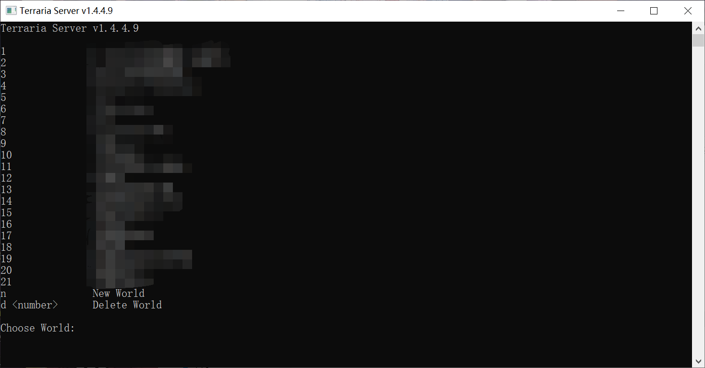

看，这就是世界选择界面了，你可以通过输入序号来选择世界  
地图文件的路径默认就是泰拉瑞亚相同的地图文件路径，当然，也有办法选择其他路径的地图，详情可以参考[**Pt.3-2.TShock启动命令行参数**](./TShockTutorial2.md#pt-3-2-tshock启动命令行参数)  
输入“n”或“新”可以创建新世界，不过这个建议在Terraria游戏内进行  
输入“d”或“删”可以删除世界  
现在不妨输入1选择第一个世界，然后出现这个  
这里是决定服务器中最多的玩家数，回车可以选择默认值8人

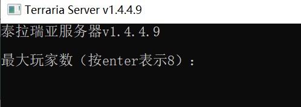

那么这里直接回车吧

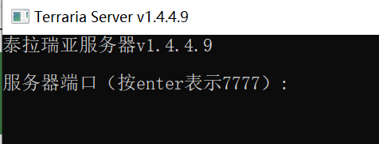

端口选择，就是你的服务器侦听的端口，回车是7777（Terraria经典默认服务器端口）  
**这个玩意影响到了你输入IP后的端口应该填什么，如果你不是独立ip，请输入服务提供商给你的端口**

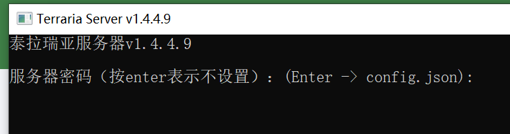

是否自动转发端口，这个一般都是默认回车就好了


输入服务器密码，一般在私人/群服务器玩耍时使用，按回车表示不设置密码  
很明显，到目前为止，你应该可以发现<strong>在启动服务器并选择世界之后可以一路回车按到底</strong>对吧...  
好了，你现在应该会看见窗口里出现

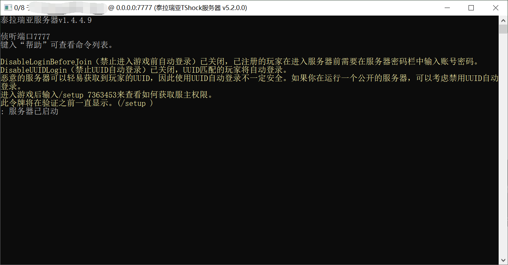

<strong>注意：现在不要关闭窗口，请记住黄字中"/setup"后面的数字，最小化窗口  
注意：有时候电脑防火墙会自动在此时提示某应用程序将允许通过防火墙，选择允许即可</strong>  
Terraria，启动！

### 获取服主权限

启动Terraria之后选择<strong>多人游戏</strong>，**通过IP加入**，选择游戏角色后来到这个界面

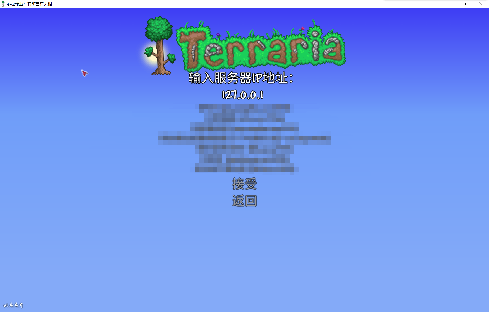

**此处重点！**  
现在，在输入框内输入<u>*127.0.0.1*</u>，端口写7777(或者前面设置的端口)，加入服务器  
<strong>127.0.0.1是指向自己计算机的IP地址  
也就是说，如果服务器不是在你自己的电脑上，你就要输入服务器商提供的ip地址和端口</strong>

::: details 服务器商提供的ip举例
服务器商会给你提供ip或者域名以及端口，例如:  
我的ip是：49.235.218.30（虚构的） 端口7770  
简幻欢举例：爱你羽学哥哥.simpfun.cn 端口xxxxx（虚构的，ip和端口都需要更根据实际情况）  
喵云举例：我超迅猛龙.miaovps.com 端口xxxxx （虚构的，ip和端口都需要更根据实际情况）  
（以上都可能需要调整安全组或者nat转发，详细请去服务器提供商处提问，他们会很乐意回答你的问题）
:::

**例如：114.114.14.51（ip）或者xnn.com（域名）**  
好了，如果操作没有错误，那么你将成功进入自己的TShock服务器

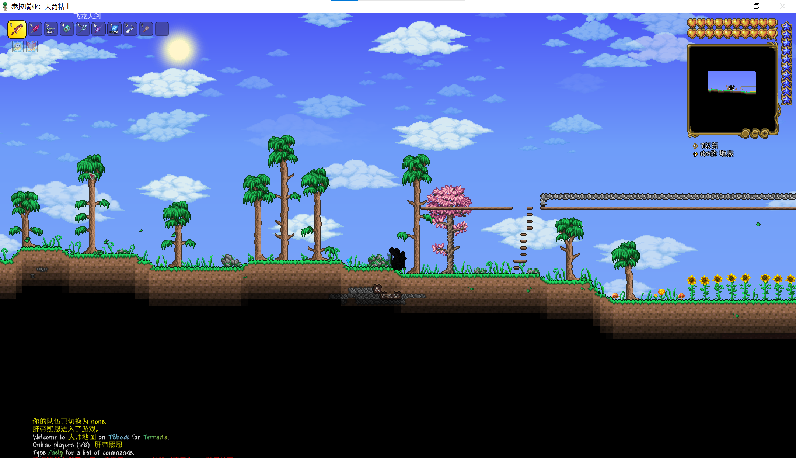

呐，可以看到左下角的欢迎文本，后面我们还会学习如何修改这个欢迎文本‘  
现在还记得之前的setup数字吗？  
打指令要点：<s>打字要快，姿势要帅</s>  
打字要准，<strong>回车</strong>要狠  
什么？你到现在不知道在哪里打指令？？？  
你玩过多人模式吗？没有？？  
好吧当我没问  
**按回车键即可打开聊天栏**  
输入/setup `<你的setup码>`  
**注意：每个TShock生成的setup-code都是不同的**，这里仅做示例，<s>不要指望用这里的验证码熊服</s>

输入完了就是见证奇迹的时刻了

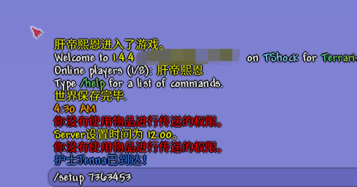

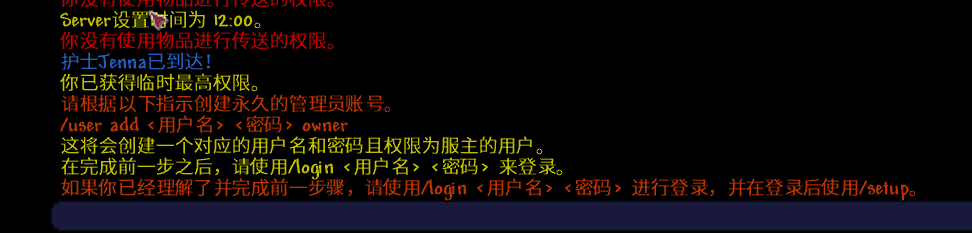

可以看到黄字的说明信息  
**现在，你将接触到tshock的第一个重要指令**  
/user add `<用户名> <密码>` `<用户组>`  
用途是<strong>将一个用户加入到指定的用户组</strong>  
例如/user add 肝帝熙恩 1234567 owner

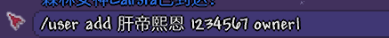

::: details 追加注释
owner组是tshock现在的服主组（**参与游戏流程的服主不要再使用superadmin组了**）  
owner组不具有*tshock.ignore.bypassssc*权限，因此<strong>可以在SSC模式下正常参与游戏流程</strong>  
同时owner组具有*tshock.su*权限  
该权限允许owner组的成员使用/su临时将自己提升为superadmin以便执行指令  
以及/sudo指令来绕过单条指令的权限检测  
对于已经添加至superadmin组的用户，可以通过下面的指令修改至owner组  
**/user group 用户名 owner**
:::

上面的用户名和密码自己改，指令规范参考下面指令规范楼#5


就可以获取<strong>永久服主权限</strong>了  
然后拥有了账户肯定要登录对吧？  
**现在你将接触到tshock的第二个重要指令**  
/login [用户名] [密码]  
用途是<strong>通过指定的用户名进行登录</strong>  
例如此处我们输入  
/login 肝帝熙恩 1234567

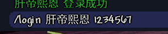

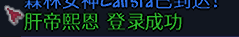

**出现了上面的绿色文字，说明你已经完成了TShock使用的第一步：获取永久服主权限**  
再次输入/setup后，setup指令就会显示失效了，同时弹出说明：

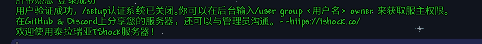

此时如果打开TShock目录，会发现多出了一个tshock文件夹，里面有很多东西

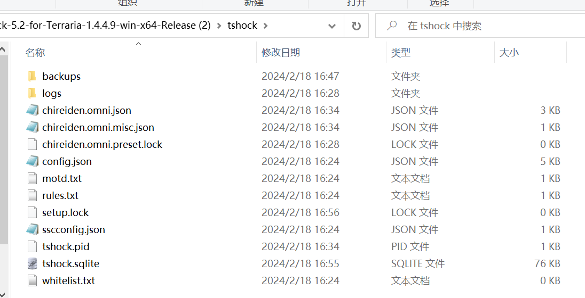

如上，setup.lock文件的出现也说明认证系统已被禁用，其余文件的介绍将在猴戏教程中补充  
现在进入游戏界面，Esc->设置->保存并退出

### 妥善地关闭服务器

现在回到<strong>后台</strong>界面

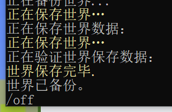

在这里<strong>输入off来保存地图并关服</strong>，**直接点击X会导致地图数据丢失！  
Tips:  
当你的服务器被恶意破坏后的短时间内你可以通过/off-nosave或直接点击×来回档(当前/off-nosave失效中，预计下版本修复)  
有时候可以将服务器状态恢复到被恶意破坏前**  
同样出现保存数据的文字，文字滚动完毕后黑色窗口会自动关闭

### 指令说明规范：

#### 0.关于指令非常重要的一点

记忆指令最好记英文，一时半会儿想不起来用法的时候看第三条

#### 1.指令的标准形式：

"指令前缀符号"指令 `<参数1/子命令> <参数2>` [参数3] ……  
例如：  
/user add 棱镜 1234567 superadmin  
"/" 就是指令前缀符号  
user 就是指令  
add可以称为“user指令的第一参数”或“user指令的一个子命令”  
棱镜、1234567、superadmin都是参数  
参数就是指令后第一个空格起的所有以空格为分割符号的一组数据  
参数与参数（包括子命令）、参数与指令之间都要有空格分割，否则会视为一个参数  
参数写在不同的位置会有不同的含义，例如“棱镜”是用户名，1234567是密码  
<u>如果写反了就会导致1234567是用户名，“棱镜”是密码</u>  
这一点是非常重要的

#### 2.指令介绍的标准形式

参数前后的括号表示了该参数是否可省略，且<strong>括号都无需输入  
我们通常用`<>`代表必填参数，[]代表选填参数</strong>  
例如：  
/user add `<账户名> <密码>` `<用户组>`  
这样的括号表示参数不可省略  
一般来说，省略参数会使tshock用默认值来代替参数  
也可能是同一个指令的不同含义，这个后面会介绍到  
例如这样的指令  
/i `<物品id>` [数量] [前缀名字/id]  
这里面，只有物品id是必填，其他不填会有默认值代替，数量通常为该物品的最大堆叠值，前缀通常默认为无

#### 3.获取指令的默认帮助

一般来讲，指令都可以用/help `<指令名称>`来获取帮助  
或者将“help”（不带引号）用作某指令的第一参数  
这样会向指令使用者发送默认的（或作者填写的）指令帮助消息  
例如：

```text
/help i
```

返回：

```text
/item help:
给自己一件物品。
```

再例如：

```text
/ban help
```

返回：

```text
TShock Ban帮助
可用Ban指令:
封禁 add <Target> [Flags]
封禁 del <Ban ID>
封禁list
封禁 details <Ban ID>
快速使用: ban add Server "恶意捣乱"
如果你需要了解更多信息，请使用ban helpcommand或者ban helpexamples
```

要是有插件作者没写help相关的内容，可以去其相关发布站提建议  
此说明留作备忘，以后指令讲解也会按照这个来

## Pt.1-2.【实用】强制开荒的基本实现

当你看着别人家的服务器进服石化，必须强行进行登录之后获取新的背包，你是否垂涎不已？  
<s>无论你是否垂涎不已，反正现在就更这个了</s>

::: details 【选读】什么是SSC
SSC，全拼Server Side Character，意为<strong>服务端角色存档模式</strong>  
在此模式下，基本玩家的所有数据都将保存在服务端的<strong>tshock.sqlite</strong>中（插件自己的当然除外）  
SSC的第一个特征就是强制开荒，所谓强制开荒也只是SSC的一部分：初始化默认背包  
SSC最强大的地方在于允许TShock服务端直接对玩家存档进行编辑，  
这种编辑不仅包括背包数据，甚至包括位置、杀怪数、生命值等  
**一般来说，一个正常的开荒/生存服务器都会开启SSC模式**
:::

### Step1.认识配置文件

现在，打开你的TShock目录，**不要急着运行服务器（如果你跳过了前面的教程，那么先运行服务器并获取管理员权限）**  
现在进入TShock目录下的<strong>"tshock"文件夹：</strong>

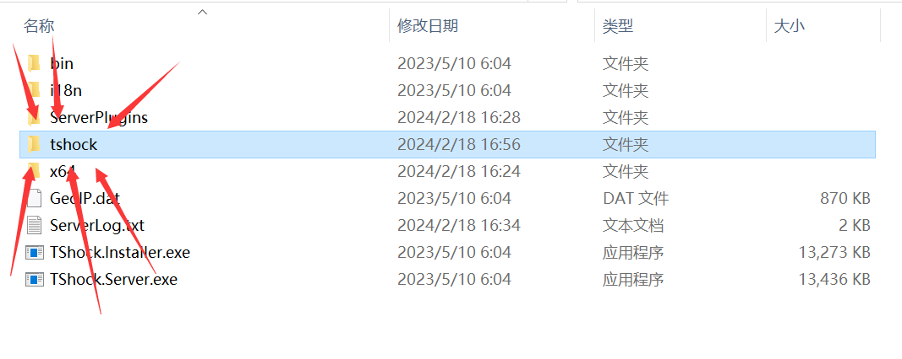

找到一个叫<strong>sscconfig.json</strong>的文件：

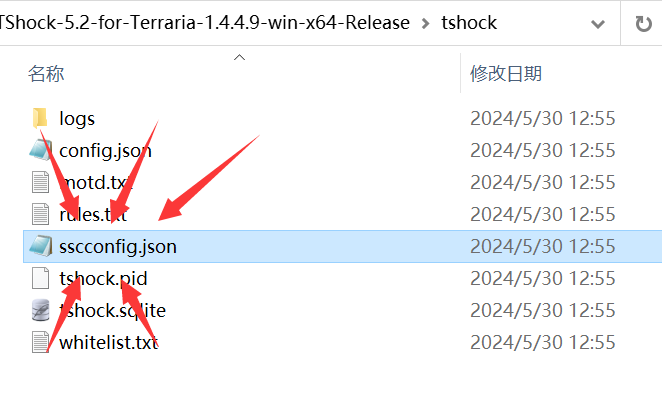

这个就是SSC的基本配置文件了  
通过对此文件的编辑，你可以实现几乎所有强制开荒的功能。  
好了，现在你可以打开这个文件了  
啥？不会打开Json？请自行上网寻找Visual Studio Code（简称VSCode或VSC）又或者Notepad++(更推荐，轻量)，这是一个代码编辑器，教程里均以VSC演示  
安装完成后右键文件你应该可以看到“通过 Code 打开”选项了，点这个，你就会看到文件内容界面了

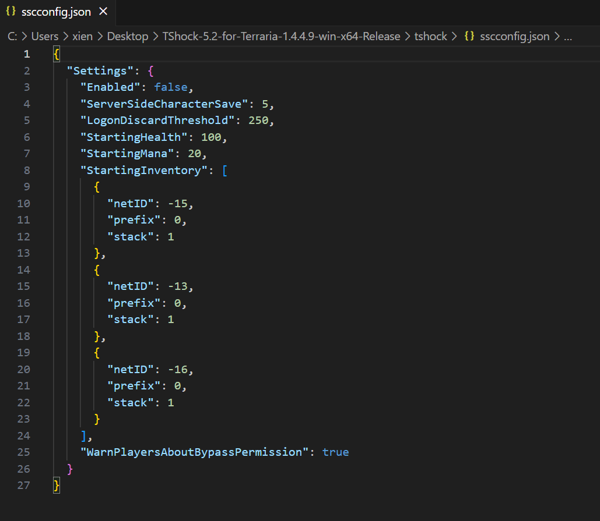

如图：

- Enabled(启用状态)是一个true/false<u>(后称bool)</u>值，**当值为 false, SSC禁用; 当值为 true, SSC启用**
- ServerSideCharacterSave(云存档保存间隔)是服务端存档数据的保存间隔时间，**以分钟为单位**
- LogonDiscardThreshold(登录后多少毫秒内不允许丢弃物品)在启用 ServerSideCharacters 时，登录后多少毫秒内不允许丢弃物品
- StartingHealth/StartingMana(初始生命值/魔法值)：只要不要填奇怪的数据就好了
- StartingInventory(初始背包)这一项比较特别，后面会单独说明

::: details 【推荐阅读】TShock中Json文件部分符号含义
之前在犹豫要不要写这个...想想还是写了吧...  
有一定面向对象编程基础的可能会很容易理解这个东西，反正我讲一讲就完了对吧  
一般来讲，大括号包裹的内容是一个完整的“对象”，什么是对象呢？  
打个比方，你和我都是人，我们又拥有与众不同的<strong>属性</strong>  
比如我<s>长得比你帅</s>  
比如我<s>比你菜</s>  
对吧？那么在这个Json中你可以看到两种大括号  
<strong>大括号中左侧由引号包裹的文本可以看做该对象的某个属性的“值”  
冒号左侧是属性，右侧为此属性的值</strong>  
那么在这个json中有几种对象呢？  
我们不妨认为拥有同种“属性列表”的对象是同一种对象，那么这里有几种对象？  
没错，两种，一个是最外层的"配置文件"对象，这个对象在TShock程序中提供了SSC的基础信息  
另一个是在中括号中的对象，等等，那个中括号是什么鬼？  
**中括号可以表示为“一组东西”，这个“东西”可以是值，也可以是对象之类的任何东西**  
学过编程的很快会联想到数组对吧？  
这个中括号不如看做一列房子，每当有“对象”要住进来就给他留个位置  
然后下面的每个物品的中括号代表的就是“物品”对象  
**中间的逗号就是房间与房间之间的空地，必须得有！**  
但是最后一个房子肯定就不需要隔断了对吧？  
所以中括号中的最后一个对象后面不需要隔断  
**任何JSON文件的格式规范都是统一的，可以使用[在线工具](https://www.jsonla.com/)来校验格式**
:::

### Step2.配置文件的编辑

*<strong><u>编辑绝对注意事项：不要缺失任何英文逗号/引号/括号！！！</u></strong>*  
（另外：打稿子的时候要插入链接，然后莫名其妙自己追踪过去了，然后我码了2个小时一千多字的稿子丢了）  
（这个故事告诉我们在电脑上工作一定要<strong>随时保存...</strong>）  
首先，如果我们要启用SSC，那么请<s>小心翼翼地</s>将<strong>Enabled</strong>改为<strong>true</strong>

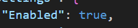

然后让我们来尝试编辑玩家的初始生命值与魔法值，例子这里设为200、100

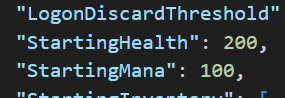

然后让我们来编辑玩家背包  
针对背包物品这样的复杂对象，我们还会一个个手打？  
开玩笑，当然是<strong>复制粘贴</strong>大法好啊

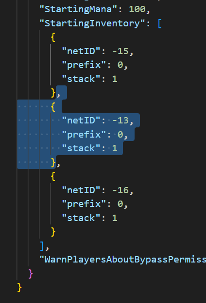

我们选中其中一个块，按下Ctrl+C，然后在最后一个物品后面多Ctrl+V几次...

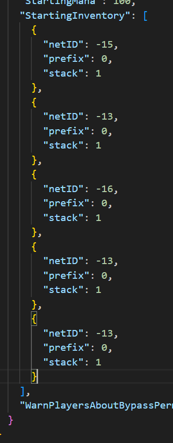

这样就实现了向初始背包里添加更多物品，修改NetID可以更改物品类型，stack更改数量，prefix更改前缀  
比如我们想将初始背包设定为传奇铁剑、传奇铁镐、传奇铁斧、木材*100，那么你的StartingInventory看起来是这样的：

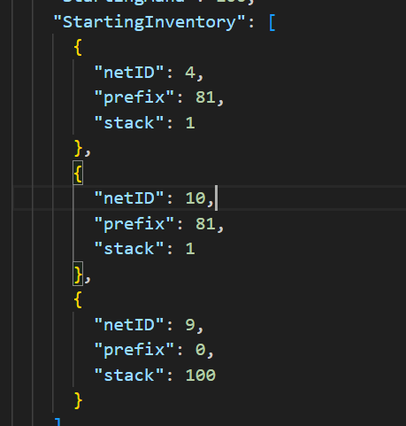

完成编辑后，<strong>保存（Ctrl+S）</strong>，关闭编辑器

### Step3.运行服务器

现在，回到你的TShock目录，按照Pt.1-1方法运行服务器即可  
**复习：加入自己开的服务器应该怎么做？**

::: details 答案
**多人游戏 -> 通过IP加入 -> 选择人物 -> IP输入127.0.0.1，端口和密码是你在服务端里设置好的  
127.0.0.1是指向自己计算机的IP地址  
也就是说，如果服务器不是在你自己的电脑上，你就要输入服务器商提供的ip地址  
例如：114.114.14.51（ip）或者xnn.com（域名）**
:::

如果你发现以<strong>普通用户(不是超级管理员)</strong>身份加入服务器时弹出如图的提示，那么说明SSC成功开启了

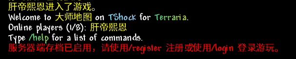

<strong>要点来了：  
注册指令：</strong>  
/register `<密码>` 允许一名普通玩家用`<密码>`中的密码注册[用户](https://www.bbstr.net/threads/tshock.381/post-3685)  
**登录指令：**  
/login [用户名] [密码] 以指定的密码与用户名登录，**你之前登录超级管理员账号就是用的这个**

注意，这个指令中的用户名和密码都是可以缺省的  
如果缺省用户名，表示用玩家角色的名字当做用户名，再以指定密码登录

如果两个都缺省，就会视为“以UUID登录”，**UUID是泰拉瑞亚每一个玩家角色随机的、唯一的全局识别代码，记录在一台设备上，也就是说，一台电脑的所有角色的UUID都是相同的（但是，实际上可以更改，此处不教）**

**千万记住，不要设置如：123456,114514这种极其简单的密码，宁可因为密码太复杂忘记密码，然后找服主用/user password `<用户名> <新密码>` 重置，也不要设置简单密码**

::: details 【字数少】【建议阅读】两个指令的一些扩展介绍
一般来讲，在不修改配置的情况下：

- 注册指令<strong>不能指定用户名</strong>
- 自动登录在没有更换玩家存档的情况下允许<strong>进服自动登录</strong>
- register创建的其实是<strong>User</strong>，后面会讲到
- login指令可以<strong>登录任何服务器数据库中存在的账户</strong>，只要你知道这些账户的密码
:::

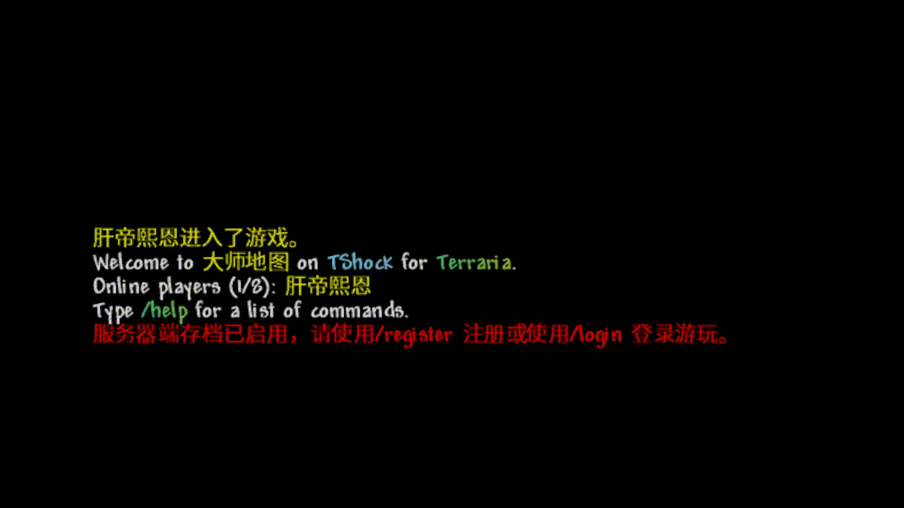

登录完了之后就会看到自己的背包变成sscconfig里设置的背包了

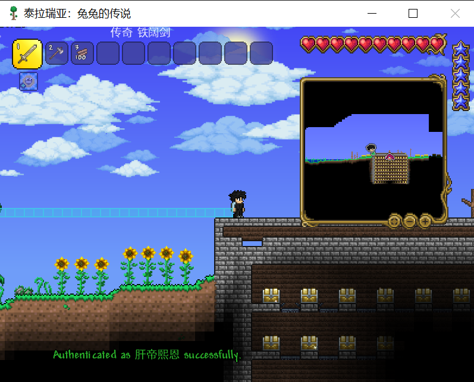

确认完毕后，**记得输入指令保存关服！**  
ok,截止至2019年11月7日，SSC基础设置基本讲解完毕  
终于把之前丢的稿子补齐了，不容易啊  
（肝帝熙恩：很难想象发生了什么，但是我给你留下这段话了！截止2024年2月15日）

**下期预告：用户、组与权限  
是一些比较理论化不好实践  
但是用好了会非常强大的东西**  
你还在等啥？等我给你留个彩蛋？  
**赶紧整理笔记完了复习实践啊！**

## Pt.1-3.用户、组与权限的管理

权限组管理是TShock插件的一大特色  
通过权限组，你可以为玩家<strong>分配职能</strong>，**控制玩家的行为**，以及为玩家赋予聊天前缀、颜色等

### 一、权限

什么叫权限？  
我在第一章的时候粗略地提到过对吧...  
一条权限可以被表示为一个字符串，例如tshock.world.modify  
拥有这条权限的玩家才可以对世界进行编辑操作(建造、破坏等)  
打个比方，tshock有六个默认用户组如下表

| guest | default | newadmin | admin | trustedadmin | owner | superadmin |
| --- | --- | --- | --- | --- | --- | --- |
| 游客 | 玩家 | 新手管理员 | 管理员 | 受信任管理员 | **服主** | 超级管理员（即超管） |

> PS：owner为TShock4.4.0以上版本添加的默认用户组，适用于服主希望参加游戏进程的情况  
> owner组具有权限<strong>tshock.su</strong>，自身并不像superadmin一样具有所有权限  
> 相反地，owner组的用户可以通过/su指令临时获得超级管理员权限，或是通过/sudo指令绕过权限检测  
> 这允许在owner组用户<strong>正常进行游戏</strong>（指SSC模式下不会因tshock.ignore.bypassssc权限忽略背包）时管理服务器  
> superadmin现在更多用于Rest/后台/插件中的操作，**建议不要在参与游戏流程时使用superadmin组**

下附一张权限表，列出了各个组的代表性权限  
※等级从上到下依次递增  
※更高级的组拥有较低等级组的所有权限

| 组名 | 拥有的权限(代表性的) |
| --- | --- |
| guest | 注册、登陆、发送服务器消息 |
| default | 进行受限制的正常游戏(平民玩家) |
| **vip** | 预留服务器位，重命名NPC，召唤boss/入侵，虫洞 |
| newadmin | kick玩家，查看玩家Index，设置重生点，调时间 |
| admin | ban玩家，管理传送点，生成boss/怪物，tp |
| trustedadmin | 刷/给予物品(/i和/g)，无视各种限制，上传本地存档作为SSC存档 |
| **owner** | tshock.su(使用指令绕过权限，基本等同于superadmin) |
| superadmin | 具有所有权限，**注意，这个组是只读的，无法为这个用户组手动配置权限** |

### 相关的指令

/user  
子命令列表

- add `<用户名> <密码>` `<用户组>`

这个指令很眼熟，对吧？  
没错，这个指令是你当年初次启动服务器<strong>创建owner账号</strong>的指令！  
用户组是上面列出的组中的一个  
给普通用户的就是default，  
<strong>创建</strong>备用超管账号就是owner  
如果要给已经存在的用户修改权限，请参考<strong>group</strong>子命令

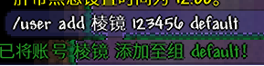

- del `<用户名>`

删除指定用户  
**在SSC模式下会同时删除背包数据**

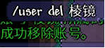

- password `<用户名> <新密码>`

改变某用户的密码  
**可用于为忘记自己账号的密码的玩家重置密码**

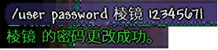

- group `<用户名> <新组>`

将指定用户移动到一个新组  
例如：/user group 棱镜 owner ---将“棱镜”这个账户移动到owner用户组

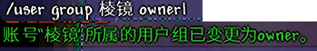

**注意：这个操作是忽视目标用户原来所在组的！**  
user指令看起来很简单对吧  
在TShock世界中，每个用户组都有对应的一组**权限  
执行特定的指令一般都需要对应权限  
有时候执行特定操作(如使用日晷、召唤入侵和boss、使用晶塔等)也需要对应权限**

### 权限：

权限，通常是以"."作为分隔符号的一串文本  
通常情况下，tshock.开头的权限是原版TShock权限  
权限的"."起到一个分组的作用，且支持“*”通配符  
举几个栗子：  
tshock.tp.wormhole --只有拥有此权限的组内的玩家才能使用虫洞药水传送  
tshock.tp.* --该权限表示拥有此权限的组拥有tshock.tp<strong>权限组</strong>下的所有权限，可以使用与/tp有关的各种子命令

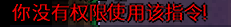

一个没有tp权限的玩家试图使用tp指令，这是他聊天框发生的变化

※以后权限中用"."分出的组都叫<strong>权限组</strong>，区别于<strong>用户组</strong>  
※注意：<strong>只有“用户组”能拥有“权限”，也就是说，用户拥有某权限是因为ta处于拥有该权限用户组，而非用户拥有权限本身</strong>  
※用比喻来说<strong>，熙恩可以在班上生活，不是因为熙恩是熙恩，而是因为熙恩是这个班普通同学的一员，拥有“在班上生活”这条权限</strong>

::: details 如果没看懂，可以回顾下前面的比喻
**指令：在TShock中表现为由指令前缀符号（如：/和 .）引导的具有特殊效果的语句**  
例如`/help`会返回tshock的指令列表  
一条指令的基本特征：有一个名称（例如help），需要一个特定权限（有些也是不需要的），能够产生特定效果  
**超级管理员：TShock系统中象征最高权限的用户组（也是后面会讲到的内容）**  
**用户：指TShock系统中为玩家创建的信息体**  
例如：玩家名称，密码，UUID等，在SSC模式下也包括玩家的角色数据（背包内容，生命魔力等）  
说白了就是玩家在服务器中的<strong>账号</strong>  
**组：指TShock系统中的用户组，用户组中的元素为用户，这些用户具有该组规定的特殊信息(权限以及花里胡哨的东西)**  
打个通俗的比方，你学校里是不是有班干部班委之类的？  
所有人类都是一个用户（<s>好吧，蟑螂也是</s>）  
普通学生就像tshock里的default（默认）用户组，有可以在班上生活的权限  
班委按照地位：（课代表）就像tshock里的admin（管理员），班长就像tshock里的owner（服主）用户组，不仅有可以在班上生活，还具有一定对其他学生的管理权力  
老师很明显就是superadmin（超级管理员），掌握所有人的生杀大权
:::

### 关于权限你需要牢记的:

- 权限意味着给予某用户组的<strong>全体用户</strong>执行某特定操作的权利
- 大多数原版TShock指令都具有对应的权限
- 权限中的通配符意味着“拥有此权限组下的所有权限”

### 用户组：

区别于“权限组”，你可以把这个看作<strong>“对服务器内玩家的划分”</strong>

### 指令：

/group  
下面为子命令列表

- 基础子命令

  - add `<组名>`  
    新建一个用户组，组名是自定义的，不能与已存在的用户组同名
  - del `<组名>`  
    删除一个用户组
  - list  
    没有参数，显示所有存在的用户组组的名称，如果数量超过一页会自动分页显示
- 聊天子命令

  - color `<组名> <rrr,ggg,bbb>`  
    设置指定组的聊天颜色，颜色格式像这样：255,0,0  
    例如/group color default 0,255,0 ---将default组用户的聊天颜色设为绿色  
    默认的颜色都是255,255,255(纯白)  
    这样的颜色表达法叫<strong>RGB</strong>，你可以通过百度进行深入了解
  - prefix `<组名>` [一串文字]  
    若省略参数，显示指定组的当前聊天前缀，否则设置该组的聊天前缀为你设置的文字  
    注意：如果你要输入带空格的文字，你可以这样输入: "xxx xxx"，用英文引号把文字括起来  
     如果要清除前缀，你可以用/group prefix `<组名>` "" 来实现
  - suffix `<组名>` [一串文字] //与前缀相同，不过设定的是聊天后缀
- 权限子命令（重点！！！！！）  
  玩家的权限就是使用下面的子命令进行管理的！

  - addperm `<组名> <权限>` //给指定用户组添加设定的权限
  - delperm `<组名> <权限>` //删除指定用户组的指定
  - listperm `<组名>` [页码] //显示某用户组的全部权限，如果较多会自动分页
  - **parent `<子组名>` [父组名] //查看/设置某个组的父组**  
    你可能（一定）会问了：啥叫父组？  
    简单说，就是子组拥有父组的所有权限，<strong>但是这个权限是归属于父组的  
    虽然你可以在子组可以看到他有的权限，但是只有你删掉了所有父组的权限才能使得子组也失去权限  
    用一个奇妙的比喻就是：</strong>你父亲是兵部的二品大员，而你是有他腰牌的礼部五品官员，你不仅在可以代使用他的兵部一品权力，还可以使用礼部五品的权利（当然我们要假设兵部管不到礼部），但是一旦你父亲如果被降为三品，那你这块腰牌的效力也只有三品了  
    这个技术有什么用处呢？  
    假设你想要一个能够像平民玩家一样游戏的组，且具有一定管理权限  
    你可以这样做来让你的这个组具有default（平民组）的所有权限  
    /group add MyGroup  
    /group parent MyGroup default  
    然后在这样的基础上，添加权限  
    /group addperm MyGroup tshock.admin.kick  
    不就很方便了嘛？
- > **Tips**  
  > 权限这个东西非常特殊，**无论加入/删除的权限是否存在/有效都会提示操作成功**  
  > 所以建议打完之后<strong>手动检查</strong>一下，比如尝试一下权限对应的指令、操作是否可以执行等（先确认是添加权限的组的用户）  
  > 另外，其实权限这个东西是可以由任何字符(没错，中文权限是存在的)组成的，而且tshock内部的权限检查也有很多骚东西，后面会讲  
  > 再就是如果你要赋予某组玩家所有传送相关的权限，你可以使用/group addperm `<组名>` tshock.tp.*  
  > 正如前面权限组所说，*表示该权限组下的所有权限
- 然后是原版TS的权限列表，现在github上TShock的wiki上我已经提交了中文版的文档  
  大家直接去[官方wiki](https://github.com/Pryaxis/TShock/wiki/(%E4%B8%AD%E6%96%87)-%E6%9D%83%E9%99%90%E8%AF%B4%E6%98%8E)下载或直接看就好。如果github打开慢也可以看我[gitee镜像](https://gitee.com/THEXN/TShock/wikis/(%E4%B8%AD%E6%96%87)-%E6%9D%83%E9%99%90%E8%AF%B4%E6%98%8E)的  
  好了，本期教学到此结束  
  虽然讲得比较抽象（真相是棱镜懒得截图）  
  但是如果你边看边做应该还是比较好理解的吧  
  如果有问题可以留言或者联系棱镜哦QwQ（现在别联系了，差不多退坑了）  
  （肝帝熙恩：我擦，你好可爱，有问题可留言，不回答弱智问题）

## Pt.1-4.开服实践环节【基于游侠联机平台】【2020-01-09更新】

**但是游侠已经要付费使用了，所以我这里变成：**

## Pt.1-4.开服实践环节【基于云服务器】【2024-02-18更新】

这里首先推荐一个帖子TShock[默认权限组缺失的权限（点我）](https://trhub.cn/threads/ezperm.30/)  
这边介绍了一下TShock自带的Default组所缺少的权限  
所以你可以根据那个帖子自行先添加一下（插件安装后直接使用/inperms就好了，什么？你还不会安装插件：[**详细可看Pt.2-4.TShock插件的使用**](./TShockTutorial2.md)）

### Step1.打开云服务器

云服务器哪来？这里我推荐：  
[喵云](https://www.miaovps.com/)  
[腾讯云/](https://cloud.tencent.com/)[阿里云](https://cn.aliyun.com/)的双11或者618，且你是新用户，除了这种情况其他都不要买大厂的，纯坑  
或者你去用简幻欢/wemc之类，因为用他们教学效果比较局限，所以不用其进行演示  
我这里使用的是腾讯云的机子，独立ip（不知道独立ip是什么的去网上查）

### Step2.在云服务器上安装tshock

我的云服务使用的winserver2012r2，不建议大家使用，此处仅做示范  
不会安装？请回到最上方，重新开始  
然后正常启动tshock，这里有一点需要注意，如果你购买的是nat云，如果服务器商只提供部分端口，例如15555-15565  
那你开服时候端口只能选择这里面的其中一个  
我这里以端口7770做示范

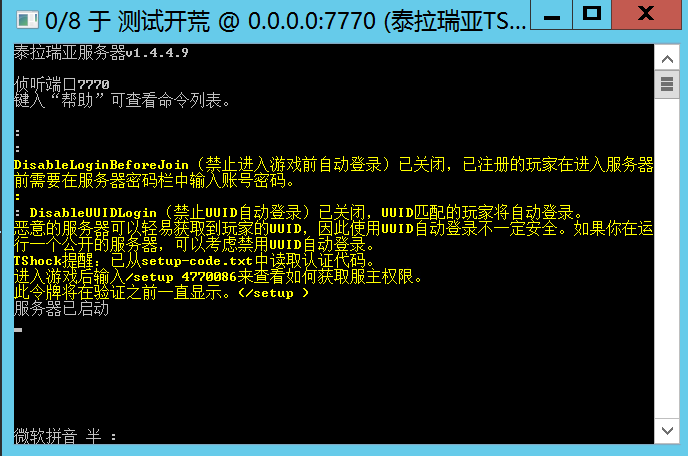

### Step3.将IP端口发送给朋友（和你自己）

服务器商会给你提供ip或者域名以及端口，例如:  
我的ip是：49.235.218.30（虚构的） 端口7770  
简幻欢举例：play.simpfun.cn 端口xxxxx（ip和端口都需要更根据实际情况）  
喵云举例:xnnxml.miaovps.com 端口xxxxx （ip和端口都需要更根据实际情况）  
（以上都可能需要调整安全组/nat转发，详细请去服务器提供商处提问）

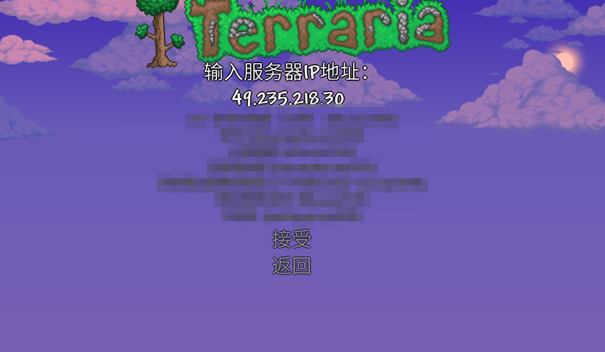

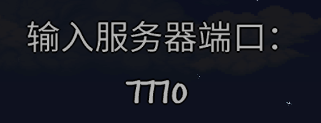

然后你和你的朋友就能在一起玩耍啦  
服务器商会给你提供ip或者域名以及端口，例如:  
我的ip是：49.235.218.30（虚构的） 端口7770  
简幻欢举例：爱你羽学哥哥.simpfun.cn 端口xxxxx（虚构的，ip和端口都需要更根据实际情况）  
喵云举例：我超迅猛龙.miaovps.com 端口xxxxx （虚构的，ip和端口都需要更根据实际情况）  
（以上都可能需要调整安全组或者nat转发，详细请去服务器提供商处提问，他们会很乐意回答你的问题）

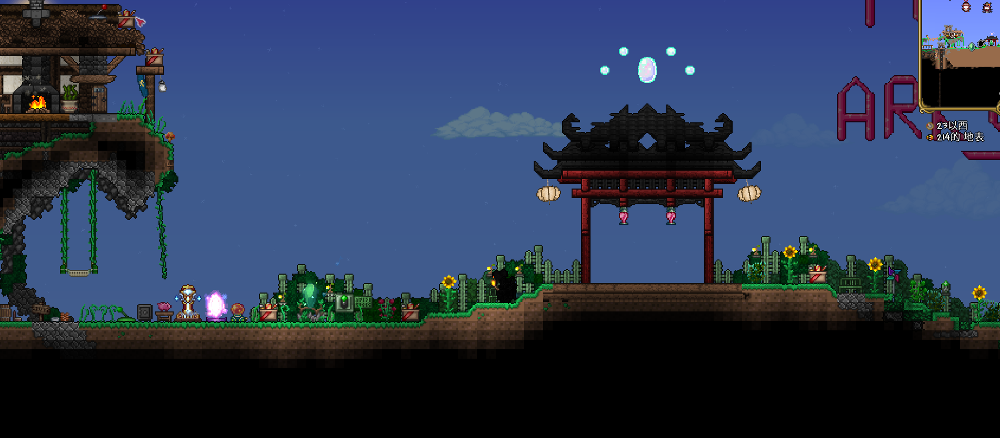

## 【内容追加中】Pt.2-1.游戏内功能指令

### 介绍格式：主指令+含义

### 第二行起为子命令，输入子命令不需要带“-”，关于子命令请参考前面的指令标准章节

| 指令：warp | 含义：传送点管理 |
| --- | --- |
| 不带参数 | 显示warp指令的默认帮助 |
| `---add <传送点名>` | 将你当前的位置记录为名为`<传送点名>`的传送点 |
| `---del <传送点名>` | 删除指定名称的传送点 |
| `---<传送点名>` | 传送至指定的传送点 |
| `---hide <传送点名> <true/false>` | true:隐藏传送点 false:取消隐藏 |
| ---list [页码] | 显示所有传送点(数量较大时分页显示) |

- hide为true(真)的传送点不会在/warp list 中显示，但可以被正常使用，用于隐藏私人传送点时非常好用
- 普通玩家(不具有tshock.admin.warp权限的玩家)只能使用/warp `<传送点名>`，输入其他指令会显示“不存在名为`<子命令>`的传送点”
- 不能添加重名传送点

| 指令：region | 含义：领地管理 |
| --- | --- |
| ---[页码] | 查看可用的指令说明(不带help，注意) |
| `---set <1/2>` | 记录第一个/第二个临时点 |
| `---define <领地名>` | 以记录的两个临时点为左上/右下角建立新领地 |
| `---delete <领地名>` | 删除指定领地 |
| ---name | 敲击一个物块，获取其所在的领地的名字 |
| `---rename <领地名> <新名字>` | 给指定领地重命名 |
| ---list [页码] | 列出所有领地 |
| `---resize <领地名> <u/d/l/r> <数量>` | 重设领地大小，u/d/l/r表示向上/下/左/右增加`<数量>`格 |
| `---allow/remove <用户名> <领地名>` | 将指令共享/取消共享给指定用户 |
| `---allowg/removeg <组名> <领地名>` | 同上，把用户换成用户组 |
| `---info <领地名>` | 显示一个领地的相关信息 |
| `---protect <领地名> <true/false>` | 启用/关闭领地保护 |
| `---z <领地名> <数值>` | 设置重合领地优先级（？） |
| `---tp <领地名>` | 传送到指定领地 |

## Pt.2-2.TShock基础配置文件的修(魔)改

*<strong>引言：</strong>*  
当你在TShock相关目录下看到各种Json文件时，你是否感到迷茫困惑<s>（蠢蠢欲改）</s>？  
不要着急，本章将为你详细介绍TShock的各种<s>魔法</s>配置文件！  
还记得这些吗！  
*<strong>题外话（但是很重要）：你还记得json的修改规范吗？</strong>*  
***另：附来自我自己，但是参考@Jonesn的TShock文件表一份***

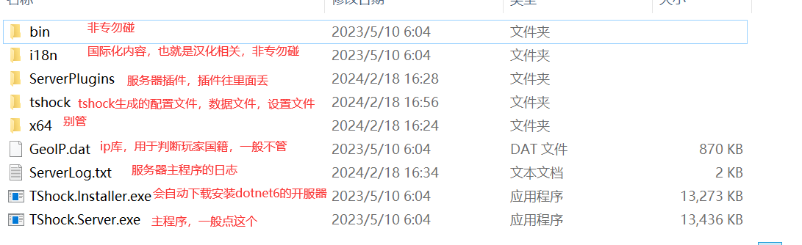

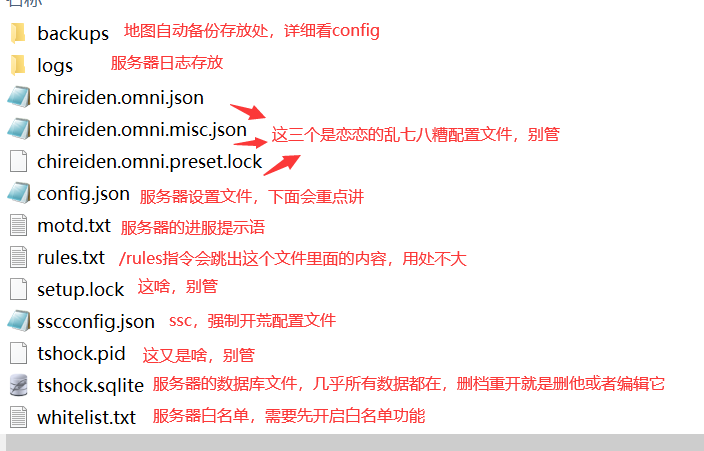

其中tshock.pid是在未使用off指令关服的时候被自动创建的文件  
在下次启动时会提醒你用指令关服...

*<strong>正文：</strong>*  
首先，举个最简单（最重要）的栗子：

### 1.config.json：服务器配置文件

<strong>用记事本或者vsc或notepad++打开  
我这里直接提供我们亲爱的羽学哥哥编写的带注释的config，请对照着改写你自己的config</strong>  
[请去附件下载查看(我塞网盘得了)](https://www.123pan.com/s/x6kKVv-0eme)

### 2.motd.txt：入服欢迎文本

看上去很简单，其实骚操作还是很多的！

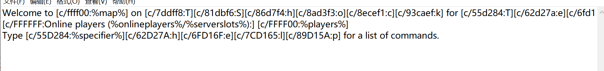

（上面是默认内容）  
<strong>motd内容是当玩家加入服务器时发送给玩家的欢迎信息  
其中用%%标记的是“变量符号”，表示“将此处的值替换为特定内容”</strong>  
最新版本可用的变量：  
1. %map% ---这个变量会被替换为服务器当前运行的世界名称。  
2. %onlineplayers% ---这个变量会被替换为当前在线的玩家数量。  
3. %serverslots% ---这个变量会被替换为服务器的总玩家槽位数，即服务器能容纳的最大玩家数。  
4. %players% ---这个变量会被替换为当前登录到服务器的所有玩家的名称列表。  
5. %specifier% ---这个变量通常用于指定TShock中的命令前缀。  
6. %xxx,xxx,xxx% ---按照RGB颜色给本行文字添加颜色(PE不可用)

## Pt.2-3.TShock与REST

*<strong>引言:</strong>*  
emmm...为什么今天会突然发一篇这样的帖子呢?  
因为最近我的好基友在论坛发布了点神奇的东西(非常大佬的东西),有用到REST,为了防止玩家们一头雾水  
于是就有了我今天这篇帖子  
（这里棱镜应该说的是bot？我也不知道）  
*<strong>什么是Rest:</strong>*  
<s>众所周知,REST就是休息的意思</s>  
咳咳,今天这个REST和英语的REST没啥关系  
来看一段很官方的解释:  
REST即表述性状态传递(英文:Representational State Transfer，简称REST)是Roy Fielding博士在2000年他的博士论文中提出来的一种软件架构风格。  
它是一种针对网络应用的设计和开发方式，可以降低开发的复杂性，提高系统的可伸缩性。


<s>(我棱镜早已料到你们看不懂这样的解释了)(棱镜自己搞不清楚的东西就不讲了)</s>  
*<strong>TShock的REST:</strong>*  
首先,你想要使用TShock的RestAPI,你需要在config.json中把这一项改为true

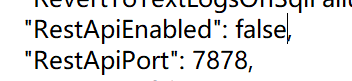

RestApiPort是rest的端口，不能服务器端口一样，使用服务器商提供的端口

然后改这个

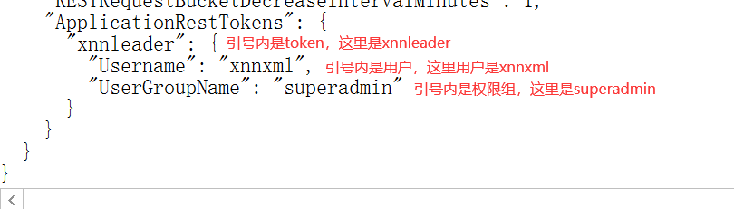

并且可以有多个rest用户，如：

```jsonc
"ApplicationRestTokens": {
  "114514": {
    "Username": "阿伟",
    "UserGroupName": "superadmin"
  },
  "19199810": { // 新增的用户令牌标识符
    "Username": "杰哥," // 新用户的用户名
    "UserGroupName": "new_user_group" // 新用户所属的用户组
  }
}
```

### 这下面的一般服主用不到，仅参考

然后启动你的服务器,<s>你可以发现什么事情也没有发生</s>  
不!你错了!接下来就是见证奇迹的时刻!  
**打开你的浏览器,输入如下的url**  
[127.0.0.1:7878/tokentest?token=token](https://127.0.0.1:7878/v2/token/create?username=%E8%BF%99%E9%87%8C%E5%A1%AB%E5%86%99%E4%BD%A0%E7%9A%84%E8%B6%85%E7%AE%A1%E8%B4%A6%E5%8F%B7&password=%E8%BF%99%E9%87%8C%E5%A1%AB%E5%86%99%E4%BD%A0%E7%9A%84%E8%B6%85%E7%AE%A1%E5%AF%86%E7%A0%81)  
比如我这里就是[127.0.0.1:7878](https://127.0.0.1:7878/v2/token/create?username=%E8%BF%99%E9%87%8C%E5%A1%AB%E5%86%99%E4%BD%A0%E7%9A%84%E8%B6%85%E7%AE%A1%E8%B4%A6%E5%8F%B7&password=%E8%BF%99%E9%87%8C%E5%A1%AB%E5%86%99%E4%BD%A0%E7%9A%84%E8%B6%85%E7%AE%A1%E5%AF%86%E7%A0%81)/tokentest?token=yuanshen  
你会发现你的服务器给了你回应!(别想了，这是我演示用的token)

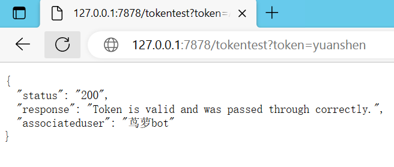

仔细一看,这个回应的格式不是JSON么?  
TShock的RestAPI内有许多"节点"(其实你可以把这个理解为"指令"),具体如链接，通过http的请求可以产生对应的返回数据与效果

官方：

[https://ikebukuro.tshock.co/#/rest-fields](https://ikebukuro.tshock.co/#/rest-fields)

我翻译的中文版：  
[https://niaoluo.top/docs/tshock帮助文档中文版/字段定义/rest-字段](https://niaoluo.top/docs/tshock%e5%b8%ae%e5%8a%a9%e6%96%87%e6%a1%a3%e4%b8%ad%e6%96%87%e7%89%88/%e5%ad%97%e6%ae%b5%e5%ae%9a%e4%b9%89/rest-%e5%ad%97%e6%ae%b5/)

正如刚刚的EndPoint执行 **测试令牌**,然后返回值中包含3个属性  
status表示返回的状态,response是状态的文本形式,associateduser是执行这个"命令"返回的结果  
(status一般在TShock的RestAPI中自动生成)  
**status值的含义:**

| Status代码的值 | 表示的含义 |
| --- | --- |
| 200 | 命令成功执行并且可能还包含一个"response"文本 |
| 400 | 命令执行失败并且会有一个error属性来告诉你更多信息 |
| 401 | 没有提供执行指令所需的密钥(大多数EndPoint都是需要密钥的) |
| 403 | 仅由获取密钥的EndPoint返回,表示账户权限不足 |
| 404 | 没有指定的EndPoint |

**Token在Rest中发挥与superadmin用户相同的作用!所以不要泄露!不要泄露!**

下接：[TShock从零开始的使用教学 - 下](./TShockTutorial2.md)
