# TShock从零开始的使用教学 - 下

上接：[TShock从零开始的使用教学 - 上](./TShockTutorial1.md)

## Pt.2-4.TShock插件的使用

### 没啥用的前言：

原本以为装插件这种事情应该是个TShock服主都会，  
但是现在发现还是有很多玩家不会的。  
而且我这个帖是要推广出去，必须完善  
所以今天简明地讲解一下安装插件的方法

### 首先是简洁的步骤

1. 下载插件
2. 塞进文件夹
3. 启动服务器
4. 检查是否能正常使用

#### Step1.获取插件

**目前棱镜/肝帝熙恩已知的靠谱的插件获取途径**

- 多名国人共同维护的插件库：[https://github.com/Controllerdestiny/TShockPlugin](https://github.com/Controllerdestiny/TShockPlugin)
- 新论坛，群友yuqing的，特点：全是中文介绍（）：[https://trhub.cn/](https://trhub.cn/)
- 另一个新论坛，维护者活跃：[https://tr.monika.love/](https://tr.monika.love/)
- 老论坛，死而复生了，bbstr.net
- tshock国内官方群聊，或者插件创作者群聊，这里只贴Tshock官方群聊：816771079
- TShock官网，特点：不用看了，已经似了
- Touhou汉化组，特点：基本都是汉化插件，量大，缺点：很散，没介绍（嗯？th汉化组吗，现在聊相关内容不多）
- GitHub(不推荐非专业人士使用)（实际内容最多，建议大家多学习怎么使用）
- discord，看不懂英文的别去了，在github的tshock介绍下能找到

<s>如果下载需要我教的话，那你可能不是正常人</s>  
如何在github上下载已经在本教程开篇就讲述，不再赘述  
一般来说，你下载的插件至少包含：  
**文件的后缀都是 .dll 的插件文件  
一个同名的.pdb文件，也建议安装上，一旦插件发生报错，这个文件可以更好的辅助开发者定位错误问题  
一般还会附带一个关于插件的介绍文件，包含该插件的功能，权限，指令  
注意事项**

- API版本是否适配(一般都是API2.1，适配PC的插件可能不适配PE，适配win的插件有极小概率不适配Linux)
- 是否有前置插件(有前置插件的一般会直接标出)
- 绝大多数插件是跨平台支持，只要能跑TS就能跑插件，但是部分有特殊说明的除外（比如曾经的map插件）

大概就这些注意事项吧......  
那么，我们就以我们国内积极维护的插件库为例  
首先，点开链接：https://github.com/UnrealMultiple/TShockPlugin

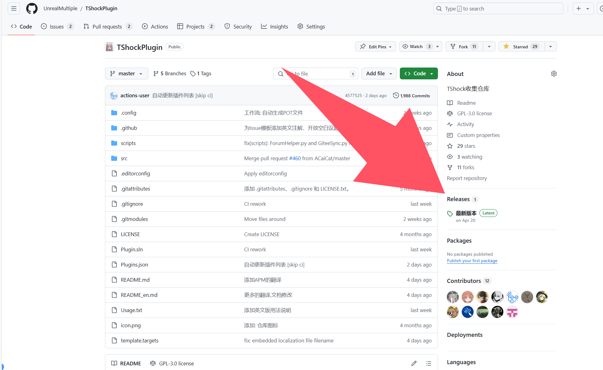


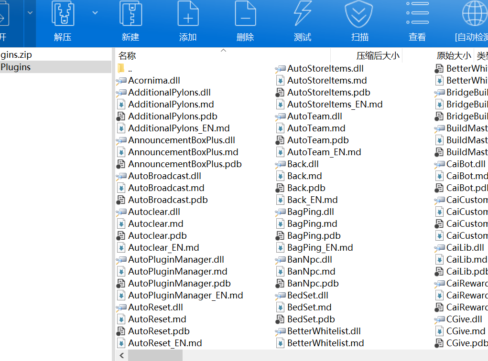

细心的同学就发现了，3个/4个文件为一组，插件本体就只有dll，md是介绍文件，可以用md查看器，或者直接拿记事本打开也可以  
主要是里面的dll（和非必须但推荐的pdb）  
如果可以建议把pdb文件也一起放到插件文件夹，一旦该插件报错，相关的pdb文件可以将报错具体行数显示在后台报错信息中，方便开发者发现问题  
你在其他地方下载的插件也同理，要注意，有些插件（比如github上）是没有提供编译好的release的，这时候需要你自己进行编译，因为涉及到编程，如果遇到，建议向相关tshock插件开发者寻求帮助（插件作者>其他开发者，优先找该插件开发者，实在不行可以去tshock官方群摇人）  
<s>好，这一步就愉快地结束了</s>

#### Step2.安装插件

复制/移动dll（和非必须的pdb）文件<strong>（如果有前置插件请按要求安装）</strong>到TShock的......  
ServerPlugins文件夹，就是下面这个

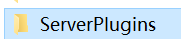

回到TShock根目录，启动/重启服务器

#### Step3.测试和使用插件

这一步其实没什么好讲的，就按照作者发布帖的介绍检查插件的功能能不能用就行  
添加的指令可以通过“/help”找到，一般插件添加的指令都会在help的最后一页，  
在没有介绍文档的情况下  
如果你知道插件的指令，但是不知道插件的权限，可以使用/whynot（前提是安装了开服教程最上方要求安装的多功能插件），或者使用/find -command [命令内容] （需要安装插件：EssentialsPlus，上方示例的插件库内有），即可查看该命令权限  
如果又没文档，又不知道指令，可以自己看源码/反编译，或者寻求插件作者或者其他开发者的帮助，实在不行你来找我

其中使用插件经常会接触到一个叫做配置文件的东西，其实就和前面说的TShock自己的config差不多的改法

#### Step4.插件报错的解决

哪下的去哪解决  
比如：github的issue，直接联系作者，群内发言需求其他开发者的帮助，论坛发帖  
请注意，提交报错信息的时候，请清晰的描述问题，提供报错发生的过程，和报错的截图或日志信息，不要问让别人向你索取信息的问题，比如：“我插件报错怎么办”，发了一句话却没有提供任何相关信息  
由于<s>棱镜太稳以至于搞不出什么报错</s>(<s>搞出来了也不会修</s>)所以不更，有问题就按上面说的去解决  
<s>现在面向各位服主开始征集插件报错信息~！</s>(错误的，不征集)

## Pt.3-1.TShock的数据存储

**警告：本章开始内容会逐渐硬核，请做好心理准备  
*建议(必须)准备的软件***

1. Notepad++（前面的教学都看了的话应该都装了）
2. SQLiteExpert（需要激活码，但是网上到处都有）或者SQLiteStudio（肝帝熙恩用的这款，免费）
3. dnSpy 6.1.3或lispy（反编译工具）
4. Visual Studio 2019（可选）

--------------------------------------------------正文--------------------------------------------------  
<s>众所周知</s>，TShock的数据存储形式是数据库.......  
什么？你不知道什么是数据库？  
建议百度，<s>看不懂就对了</s>  
通俗地讲(可能会被大佬追杀)，就是一个“包”里装着若干个表格的形式  
想一下你Excel的样子就懂了  
通过查找，你应该大致就可以知道TShock的数据都存储在这个文件里啦！

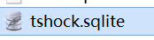

右键。Notepad++打开试试（你怎么知道我没有，所以我用记事本打开）

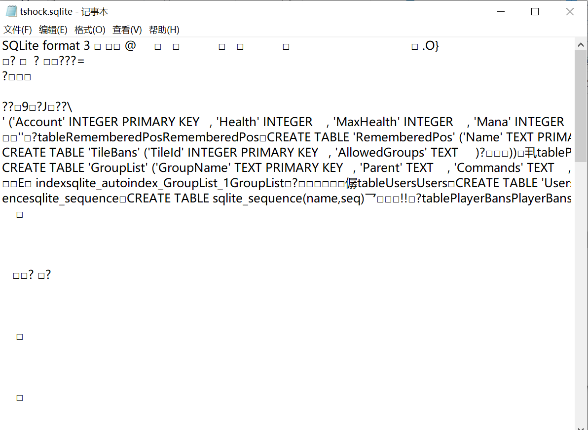

(这你要是能全部看懂那你肯定不是个人)  
数据库文件有特殊的存储形式，自然不能用文本方式打开，  
所以，我们需要专门的数据库软件来打开它

### Step1.下载并安装SQLiteExpert或者SQLiteStudio

如果你不会装软件，那么这个教学可能不再适合你阅读了  
免费版可以使用30天，但是这软件的激活码网上到处都是  
SQLiteStudio的话是完全免费

### Step2.打开tshock.sqlite

打开SQLite Expert，或者在打开文件的方式种选中SQLite Expert，  
然后就可以看到tshock.sqlite的图形化形式啦！（我这里是SQLiteStudio）  
（什么？你还不知道tshock.sqlite在哪？赶紧给我去复习前面的知识!）

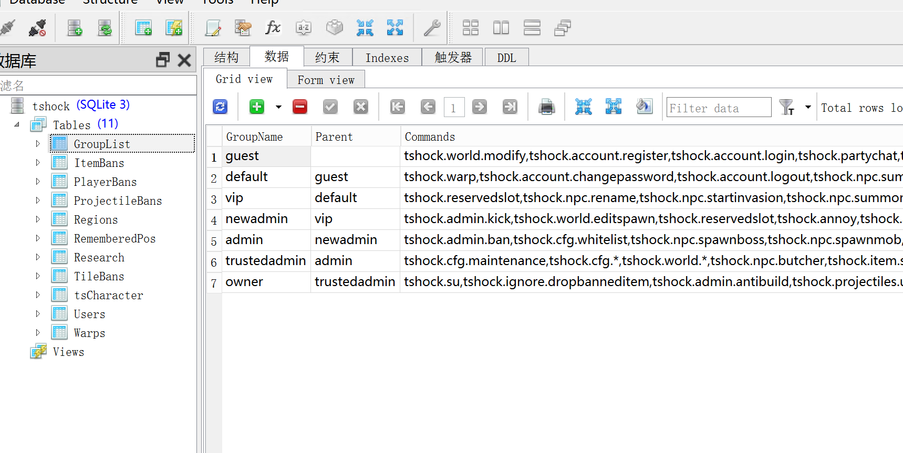

（缩略图，点击打开）

| 显示的表名 | 对应的内容 | 相关指令 |
| --- | --- | --- |
| Bans | 封禁的玩家列表 | /ban |
| GroupList | 用户组列表 | /group |
| ItemBans | 禁用的物品 | /itemban |
| ProjectileBans | 禁用的弹幕 | /projban |
| Regions | 领地 | /region |
| RememberedPos | 开启“自动传送到退出时位置”时保存的玩家退出时坐标 | config.json内容 |
| TileBans | 禁用的物块 | /tileban |
| tsCharacter | SSC模式下，玩家的角色信息 | sscconfig.json内容等 |
| Users | 玩家注册的用户和管理员添加的用户 | /user |
| Warps | 传送点 | /warp |

以上表格列出了所有TShock原版数据库中的表  
刚刚打开的数据库是一个新数据库，下面展示一个游玩了一段时间后的数据库

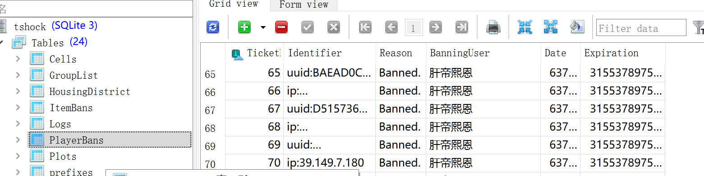

上图为封禁玩家信息表  
**包含信息从左至右为：ID(数据库内部用)，封禁类型（IP，玩家名也就是acc，玩家UUID），封禁理由，封禁用户，起始日期，结束日期**

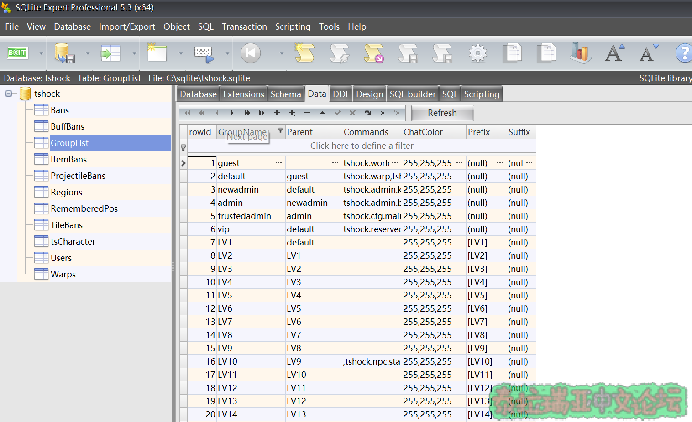

这是一个RPG服务器的组列表，揭示了一种RPG服的本质——通过用户组的分割实现等级(现在很多rgp都不用组了)  
**包含信息从左至右为：ID(数据库内部用)，组名，父组名，权限表，聊天颜色，聊天前缀，聊天后缀**  
其他表我就懒得介绍了，自己琢磨

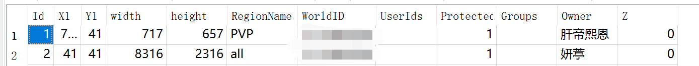

这是一个领地列表  
<strong>包含信息从左至右为：领地ID，左上角坐标(X和Y)，宽度和高度，领地名(从代码获取，存储格式特殊)，所在地图ID，拥有此领地的用户，  
是否被保护，共享的组，拥有者，Z值(优先级)</strong>  
然而，很诡异的一点是......  
还记不记得之前讲配置文件时的“数据库类型”？

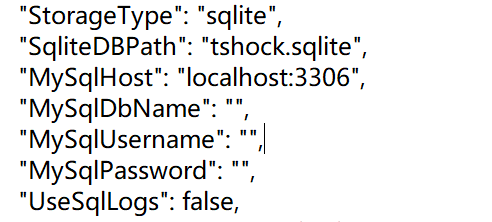

---是的，当数据库类型为MySQL时，上面的介绍依然适用  
以MySQL数据库类型启动服务器，可以实现很魔法的操作，例如多服同背包等（注意：不要用同一角色账号同时登录多个共用同一 MySQL 数据库的服务器，否则后退出的服务器存档会覆盖先保存的进度）  
这个是比较进阶的东西，建议自己去了解mysql的使用

诶，这里我们就可以涉及到一个问题了，假如我的玩家一个周目打完了，我要进行重置，该怎么办？

答案是：改地图不用多说，直接新建就好。  
接下来直接删除tshock.sqlite文件；或者编辑tshock.sqlite文件，有针对性的删除内容  
例如：我想保存所有的组，只删除用户数据，因为我给他们都分配好了权限，  
如果我直接删除tshock.sqlite文件，是不是包括组在内的所有文件全没了？  
这时候，我们就可以单独对一个表进行操作，删除其中的一个表，或者擦除他的数据，又或者编辑表中的单独某条数据  
整个界面上，鼠标悬浮在上面可以看到相关按钮是干嘛的

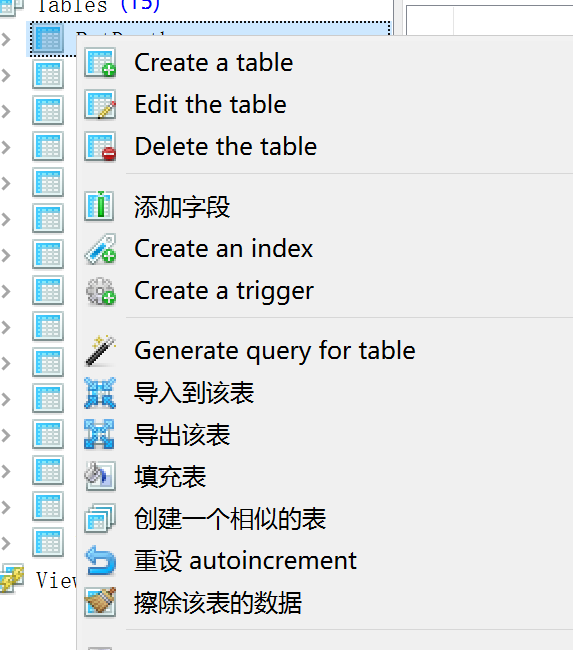

右键表可以看到一堆操作，比如擦除就是擦除其中内容，但是不删除该表  
那么如果我们只重置玩家的数据，且玩家需要重新注册，需要改一些什么呢

::: details 答案
删除或擦除“Users（玩家注册的用户和管理员添加的用户）  
删除或擦除tsCharacter（SSC模式下，玩家的角色信息）”
:::

## Pt.3-2.TShock启动命令行参数

TShock作为控制台程序.......  
哦,通俗一点说,<s>就是在黑框里面跑的程序</s>  
咳咳，不瞎扯了，简单讲就是你可以通过cmd来启动TShock，并附加一些<s>神秘的</s>参数  
云里雾里？没关系，看完这一篇教程你就会明白的

::: details 感觉没什么用的话，隐藏ing
**首先，你需要掌握在TShock目录下运行cmd/powershell的方法**  
进入你的TShock文件夹，点击“文件”，然后点击“打开Windows Powershell”

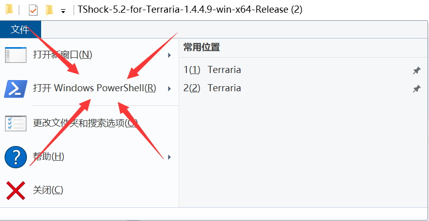

当然，在指定目录下启动cmd/powershell有很多途径，这里只是其中一种  
网上有很多相关的教程，可以自行拓展阅读  
现在你应该可以看到Windows Powershell的蓝色窗口了

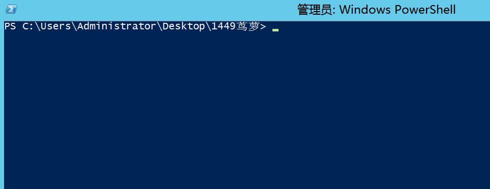

注意这里的路径，应当和你的TerrariaServer.exe在同一目录  
由于棱镜习惯用cmd，所以这里我们键入start cmd，回车  
（肝帝熙恩：不是很懂为什么这么做，我觉得不如：

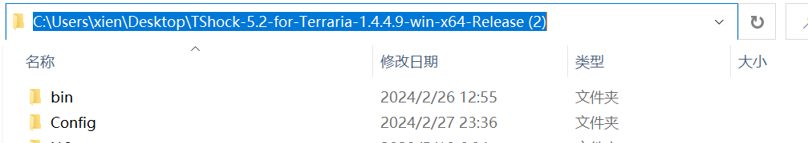

然后输入cmd，回车

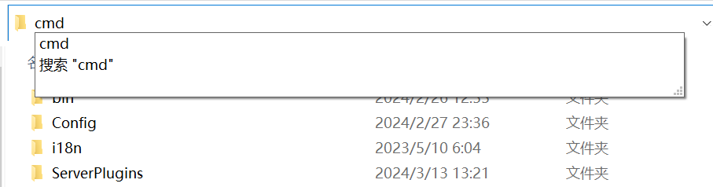

）

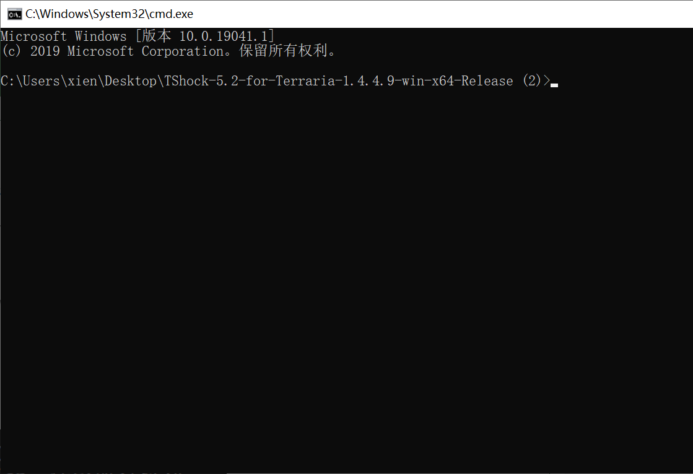

嗯，还是这个黑窗口看着舒服  
**重点来了**，<s>下一步，输入sudo rm -rf /*  
住手！这里不是Linux命令行！</s>  
咳咳，开玩笑的，然后输入TShock.Server.exe  
就可以看到TShock在命令行中运行了
:::

也许你已经注意到了，tr附带了一个.....

::: details 泰拉附带的服务器配置
```ini
#this is an example config file for TerrariaServer.exe

#use the command 'TerrariaServer.exe -config serverconfig.txt' to use this configuration or run start-server.bat

#please report crashes by emailing crashlog.txt to support@terraria.org

#the following is a list of available command line parameters:

#-config <config file> Specifies the configuration file to use.

#-port <port number> Specifies the port to listen on.

#-players <number> / -maxplayers <number> Sets the max number of players

#-pass <password> / -password <password> Sets the server password

#-world <world file> Load a world and automatically start the server.

#-autocreate <#> Creates a world if none is found in the path specified by -world. World size is specified by: 1(small), 2(medium), and 3(large).

#-banlist <path> Specifies the location of the banlist. Defaults to "banlist.txt" in the working directory.

#-worldname <world name> Sets the name of the world when using -autocreate.

#-secure Adds addition cheat protection to the server.

#-noupnp Disables automatic port forwarding

#-steam Enables Steam Support

#-lobby <friends> or <private> Allows friends to join the server or sets it to private if Steam is enabled

#-ip <ip address> Sets the IP address for the server to listen on

#-forcepriority <priority> Sets the process priority for this task. If this is used the "priority" setting below will be ignored.

#-disableannouncementbox Disables the text announcements Announcement Box makes when pulsed from wire.

#-announcementboxrange <number> Sets the announcement box text messaging range in pixels, -1 for serverwide announcements.

#-seed <seed> Specifies the world seed when using -autocreate

#remove the # in front of commands to enable them.

#Load a world and automatically start the server.

#world=C:\Users\YOUR_USERNAME_HERE\My Documents\My Games\Terraria\Worlds\world1.wld

#Creates a new world if none is found. World size is specified by: 1(small), 2(medium), and 3(large).

#autocreate=1

#Sets the world seed when using autocreate

#seed=AwesomeSeed

#Sets the name of the world when using autocreate

#worldname=Terraria

#Sets the difficulty of the world when using autocreate 0(classic), 1(expert), 2(master), 3(journey)

#difficulty=0

#Sets the max number of players allowed on a server. Value must be between 1 and 255

#maxplayers=8

#Set the port number

#port=7777

#Set the server password

#password=p@55w0rd

#Set the message of the day

#motd=Please don抰 cut the purple trees!

#Sets the folder where world files will be stored

#worldpath=C:\Users\Defaults\My Documents\My Games\Terraria\Worlds\

#Sets the number of rolling world backups to keep

#worldrollbackstokeep=2

#The location of the banlist. Defaults to "banlist.txt" in the working directory.

#banlist=banlist.txt

#Adds addition cheat protection.

#secure=1

#Sets the server language from its language code.

#English = en-US, German = de-DE, Italian = it-IT, French = fr-FR, Spanish = es-ES, Russian = ru-RU, Chinese = zh-Hans, Portuguese = pt-BR, Polish = pl-PL,

#language=en-US

#Automatically forward ports with uPNP

#upnp=1

#Reduces enemy skipping but increases bandwidth usage. The lower the number the less skipping will happen, but more data is sent. 0 is off.

#npcstream=60

#Default system priority 0:Realtime, 1:High, 2:AboveNormal, 3:Normal, 4:BelowNormal, 5:Idle

priority=1

#Reduces maximum liquids moving at the same time. If enabled may reduce lags but liquids may take longer to settle.

#slowliquids=1

#Journey mode power permissions for every individual power. 0: Locked for everyone, 1: Can only be changed by host, 2: Can be changed by everyone

#journeypermission_time_setfrozen=2

#journeypermission_time_setdawn=2

#journeypermission_time_setnoon=2

#journeypermission_time_setdusk=2

#journeypermission_time_setmidnight=2

#journeypermission_godmode=2

#journeypermission_wind_setstrength=2

#journeypermission_rain_setstrength=2

#journeypermission_time_setspeed=2

#journeypermission_rain_setfrozen=2

#journeypermission_wind_setfrozen=2

#journeypermission_increaseplacementrange=2

#journeypermission_setdifficulty=2

#journeypermission_biomespread_setfrozen=2

#journeypermission_setspawnrate=2
```

**翻译：**

```ini
#这是 TerrariaServer.exe 的示例配置文件

#使用命令 'TerrariaServer.exe -config serverconfig.txt' 来使用此配置文件，或运行 start-server.bat

#如需报告崩溃问题，请将 crashlog.txt 发送至 support@terraria.org

#以下是可用的命令行参数列表：

#-config <配置文件> 指定要使用的配置文件。

#-port <端口号> 指定监听的端口。

#-players <数量> / -maxplayers <数量> 设置最大玩家数量。

#-pass <密码> / -password <密码> 设置服务器密码。

#-world <世界文件> 加载一个世界并自动启动服务器。

#-autocreate <#> 如果在 -world 指定的路径中未找到世界，则创建一个世界。世界大小指定为：1（小）、2（中）、3（大）。

#-banlist <路径> 指定封禁列表的位置。默认为工作目录下的 "banlist.txt"。

#-worldname <世界名称> 在使用 -autocreate 时设置世界名称。

#-secure 增加额外的作弊保护。

#-noupnp 禁用自动端口转发。

#-steam 启用 Steam 支持。

#-lobby <friends> 或 <private> 如果启用了 Steam，则允许好友加入服务器或将其设置为私有。

#-ip <IP 地址> 设置服务器监听的 IP 地址。

#-forcepriority <优先级> 设置任务的进程优先级。如果使用此选项，将忽略下面的 "priority" 设置。

#-disableannouncementbox 禁用通过线路触发的公告箱文字公告。

#-announcementboxrange <数字> 设置公告箱文字消息范围（以像素为单位），-1 为全服公告。

#-seed <种子> 在使用 -autocreate 时指定世界种子。

#移除命令前的 # 以启用它们。

#加载一个世界并自动启动服务器。

#world=C:\Users\YOUR_USERNAME_HERE\My Documents\My Games\Terraria\Worlds\world1.wld

#如果未找到世界，则创建一个新世界。世界大小指定为：1（小）、2（中）、3（大）。

#autocreate=1

#在使用 autocreate 时设置世界种子。

#seed=AwesomeSeed

#在使用 autocreate 时设置世界名称。

#worldname=Terraria

#在使用 autocreate 时设置世界难度 0（经典）、1（专家）、2（大师）、3（旅程）。

#difficulty=0

#设置服务器允许的最大玩家数量。取值范围为 1 至 255。

#maxplayers=8

#设置端口号。

#port=7777

#设置服务器密码。

#password=p@55w0rd

#设置公告信息（MOTD）。

#motd=请不要砍伐紫色的树！

#设置存储世界文件的文件夹。

#worldpath=C:\Users\Defaults\My Documents\My Games\Terraria\Worlds\

#设置要保留的滚动世界备份数量。

#worldrollbackstokeep=2

#封禁列表的位置。默认为工作目录下的 "banlist.txt"。

#banlist=banlist.txt

#增加额外的作弊保护。

#secure=1

#通过语言代码设置服务器语言。

#英语 = en-US，德语 = de-DE，意大利语 = it-IT，法语 = fr-FR，西班牙语 = es-ES，俄语 = ru-RU，中文 = zh-Hans，葡萄牙语 = pt-BR，波兰语 = pl-PL。

#language=en-US

#自动使用 uPNP 转发端口。

#upnp=1

#减少敌人跳帧但增加带宽使用。数值越低跳帧越少，但发送的数据更多。0 表示关闭。

#npcstream=60

#默认系统优先级 0：实时，1：高，2：高于正常，3：正常，4：低于正常，5：空闲。

priority=1

#减少同时移动的液体数量。如果启用可能减少卡顿，但液体可能需要更长时间来稳定。

#slowliquids=1

#针对每个单独功能设置旅程模式权限。0：对所有人锁定，1：仅主机可更改，2：所有人可更改。

#journeypermission_time_setfrozen=2

#journeypermission_time_setdawn=2

#journeypermission_time_setnoon=2

#journeypermission_time_setdusk=2

#journeypermission_time_setmidnight=2

#journeypermission_godmode=2

#journeypermission_wind_setstrength=2

#journeypermission_rain_setstrength=2

#journeypermission_time_setspeed=2

#journeypermission_rain_setfrozen=2

#journeypermission_wind_setfrozen=2

#journeypermission_increaseplacementrange=2

#journeypermission_setdifficulty=2

#journeypermission_biomespread_setfrozen=2

#journeypermission_setspawnrate=2
```
:::

暂时不管它  
**先随意创建一个启动.txt文件**，把：

```bat
:start
TShock.Server.exe -lang 7 -port 7777 -world "D:\文档\My Games\Terraria\Worlds\大师地图.wld"
timeout /t 5
goto start
```

复制进去，保存，然后再把.txt后缀改成.bat就好了（如何改扩展名？可回到第一篇，在Pt.1-1比较靠前的位置）

::: details linux怎么办
哦，有小可爱就要问了，linux怎么办？

```bash
#!/bin/bash
while true; do
./TShock.Server -lang 7 -port 7777 -world "/home/container/大师地图.wld"
sleep 5
done
```

复制进去，保存，然后再把.txt后缀改成.sh就好了（Linux 下首次运行需先执行 `chmod +x 启动.sh` 赋予执行权限，或直接运行 `bash 启动.sh`）
:::

这一坨东西我们来看下

```text
:start 则是个标记
重点在这行：
TShock.Server.exe 不必多说，这是你要启动的程序
后续的便是“命令行参数”：
-lang 7 切换语言模式7，即中文
-port 7777 设置程序端口为7777
-world "D:\文档\My Games\Terraria\Worlds\大师地图.wld"  设置启动的地图路径，你需要改成你所使用的地图的所在路径
timeout /t 5 表示等待 5 秒，避免启动失败时死循环刷屏
看最后的goto start
就是跳转到先前的start标记那里往下执行，这样就完成了一个使用汉化且自动重启的服务器
```

改好后打开"启动.bat"  
诶，是不是出现了这种问题：

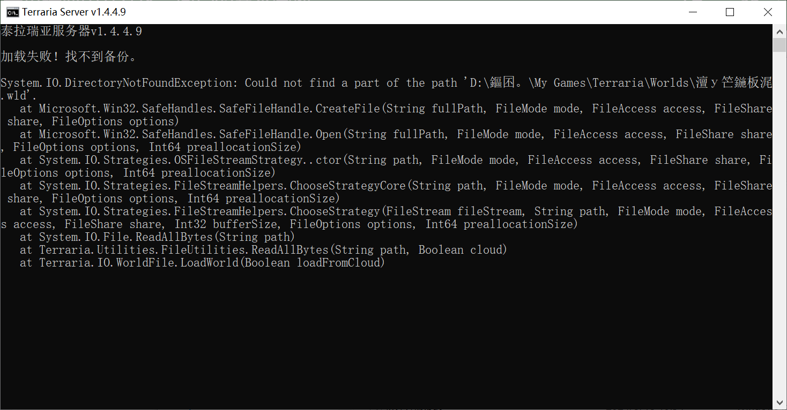

其实还是是编码的原因，你点击另存为：

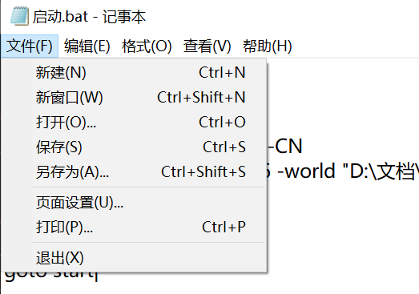

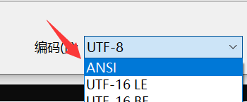

选择ANSI，保存且覆盖，就能正常运行了

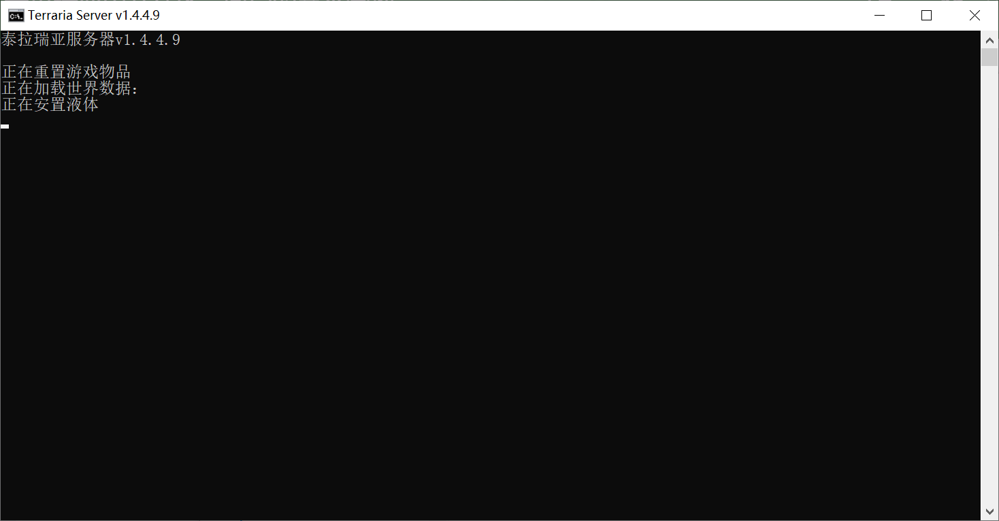

我们可以写的更<s>高级</s>点

```bat
@echo off
cls
:start
TShock.Server.exe -lang 7 -port 7777 -config serverconfig.txt
@echo.
@echo Restarting server...
@echo.
timeout /t 5
goto start
```

第一行的@echo off作用是隐藏下面一行的"cls"命令，它在windows的cmd里的作用是清空控制台输出  
就是把小黑框里的文字全部擦掉  
后面跟着的"-config serverconfig.txt"就是“命令行参数"，创建这个文件，在里面我们可以这样写

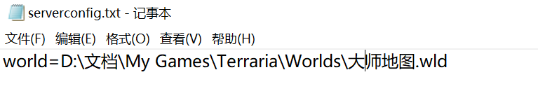

（并且这样通过文件使用不会有编码问题）  
三行@echo我们忽略掉  
先打开它，然后是正常开服流程  
接下来我们输入off,看看会发生什么

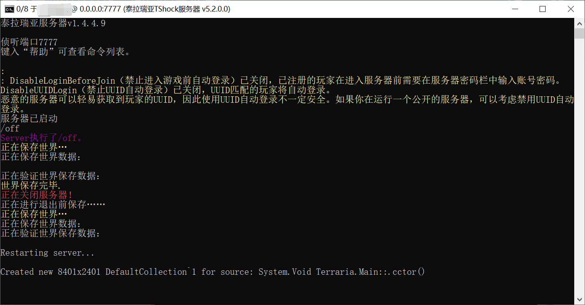

看到最后的restarting server了没  
这就时一个作用了

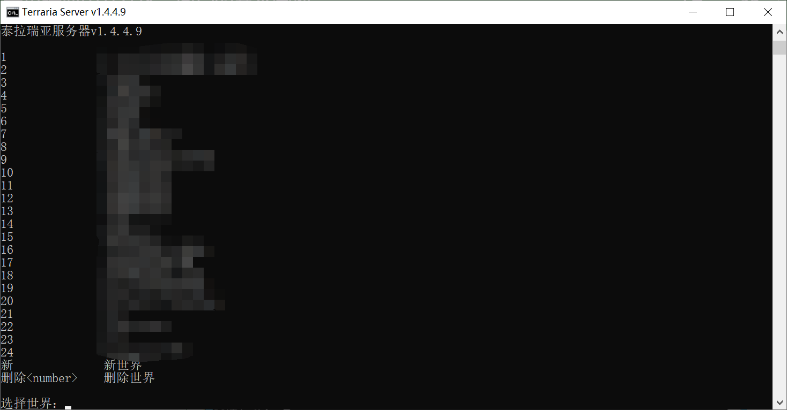

就在你刚要输入端口选择地图的时候, 它直接就给你开始加载地图了  
这样就省事多了  
而且如果你输入off  
也会自动重启并选择端口和地图（注：使用这种无条件自动重启循环时，维护期间若想彻底关服而不自动拉起，需在 `off` 后按 `Ctrl+C` 终止脚本或直接关闭脚本窗口，也可改用不带循环的单次启动脚本）  
这样做还有一个用途, 如果某天你的服务器由于种种原因突然崩服了  
像这样

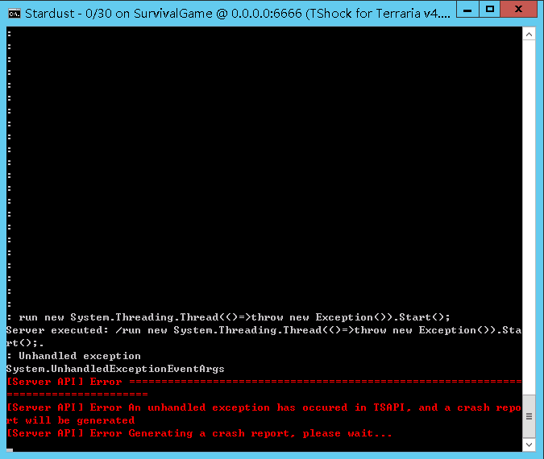

服务器就能自动重启，即使你不在  
有的人可能想问了，为什么他们这么做了却没有自动重启  
原因在这里: [关闭windows的报错窗口](https://blog.csdn.net/weixin_39270764/article/details/79855562)

啊shit，上面这个大佬，又趁我去查资料的时候夹带私货(好好好)  
没办法了就接着上面那个夹带私货的沙雕讲吧  
刚刚去翻了源码，可用的命令行参数：  
-lang 语言设置（我只知道-lang 7是中文）  
**注意：这只是把TerrariaServer.exe变成了中文，  
并不是把TShock变成了中文  
（？）**  
-world `<地图路径>` 地图设置  
-players|maxplayers `<数值>`最大玩家设置  
-port `<端口号>`端口设置  
-forcepriority 进程优先级  
-pass|password `<密码>`密码设置  
-worldname `<名称>`世界名设置（会改变地图名称）  
-motd `<文本>`对应motd.txt（？）  
-banlist `<路径>`<strong>基于原版</strong>的封禁玩家列表  
-secure 是原版自带的简易反作弊，可以预防玩家刷出超量的水啊什么的，完全没必要开，因为TShock中有该功能的上位替代，可管理的方面更多且系统更完善  
-autocreate `<大小>` 自动创建新地图  
-autoshutdown “退出后自动关服”，也就是你在游戏里直接开服时才会用到的  
-noupnp 是否开启UPnP端口映射，虽然实际没有效果  
-experimental 启用高级设置(地图种子与材质包)(为什么会出现在这里)  
-cloudworld `<路径>`Steam启动时加载云存档  
-config `<路径>` 加载Terraria配置文件（？）  
-seed `<种子>` 随机数种子？地图种子？  
以上部分使用恋恋提供的正确答案替换了  
然后我这里有一份[官方的文档](https://ikebukuro.tshock.co/#/command-line-parameters)，和我自己翻译的[启动参数文档](https://niaoluo.top/docs/tshock%e5%b8%ae%e5%8a%a9%e6%96%87%e6%a1%a3%e4%b8%ad%e6%96%87%e7%89%88/%e5%91%bd%e4%bb%a4%e8%a1%8c%e5%8f%82%e6%95%b0/)  
<s>另：本贴下方出现大量复读机</s>

## 结帖感言（吐槽环节）

算算时间，这篇教学已经有了快半年的历史  
——然而半年的时间里其实我也没能讲多少东西  
很抱歉这样突然结帖（大概很多人觉得我还会更？）<s>（烂尾丢人）</s>  
但是我觉得，这篇帖子已经没什么可以讲的内容了  
**明明觉得自己什么都讲了，但是一有人问又发现自己什么都没讲**  
但是我认为，真正认真看完了这篇帖子的TShocker们，  
**至少应该具备了初步的自学能力与探索能力**  
我希望每一个新TShocker，都能具有自己解决问题的能力  
<strong>不要总是一遇到点问题就去问专业大佬  
在这半年里我深有体会——</strong>

### 大佬的卖弱，不是别的目的，是为了逃开追问

无论一个专业人士的心态一开始有多好  
反反复复地遇到新人，问一个又一个弱智简单的问题  
**有文档不去看，有公告不去看，有源码不去看（好吧，源码不指望大部分人会看）**  
就只是伸手，完全不具有独立思考能力  
试问如果是你，你心态也应该爆炸了吧？  
是的，我的心态也已经爆炸了.......  
但是我知道也有一些新人，真正地成长了，  
**深谙提问的智慧，明白摸索的意义**  
我希望看过这篇帖子的萌新，能有所收获——  
或许不是技术上的，更重要的是心理和精神上的  
<strong>有些高科技的东西并没有那么神秘，只要尽力，也是能理解的  
有些很棘手的问题并不是那样难解，多多尝试，终究可以解决</strong>  
emmmm....就说这么多吧（感觉很中二的样子？？？）  
（其实就是我不想更了，毕竟快期末考试了）  
**帖子已经经过净化处理**

**肝帝熙恩：感谢棱镜为国内TShock社区的卓越贡献，老服主/开发者们总有一天会退休的，新服主/开发者也在不断地涌来，愿未来的玩家，服主，开发者们，都能为这个良好的社区增添一分色彩**

## TShock服务器零基础游玩指南[教学帖番外]

### 前言：

最近去很多大型服务器群走了一圈，发现貌似有很多玩家不太了解TShock服务器的特殊机制  
例如"为什么出生点的树砍不了"、“怎么不能动”“、”怎么不能移动NPC住房“  
<s>实在看不下去了</s>于是打算写这么个帖子扫盲吧  
嘛，如果你是一名服务器玩家，阅读这篇帖子将帮助你更好地在服务器中玩耍  
也算是给我之前烂尾的帖子整个番外（？）  
**如果有玩家不会操作，<s>你可以把这篇帖子的链接甩他脸上</s>**

### 注意：

本贴主要面向玩家与服务器管理员，TShock服主可以学习我的原教学贴

## Pt1-1.服务器强制开荒详解

一般而言一进入服务器后角色立即石化的服务器是开启了SSC模式的  
当然石化也可能是因为你的背包里有超数量上限的物品，这里不予讨论

### 1.什么是SSC

**SSC，俗称强制开荒**，是TShock提供的有效反作弊手段之一，由服务端控制开启  
开启SSC模式时，玩家加入服务器会受到石化，无法游戏，需要玩家进行”注册“操作  
注意：即使玩家使用作弊手段取消了石化debuff，也无法正常进行游戏，所以管理员无需担心

### 2.注册操作

进入服务器后不会注册可是不少服主头疼的问题，纵然因此产生了  
机器人注册、Chameleon自动注册、AutoRegister自动注册依然会有玩家出现无法正常游戏的现象  
因此棱镜在这里将会尽可能详细地讲解整个注册的流程

### 一、指令注册

——TShock原生的注册方式

#### Step1.准备一个新的人物存档

1. 角色名最好是字母、数字、下划线  
   因为在某些开启SQL互联或机器人注册的服务器里中文用户名总是会导致奇怪的问题
2. 为什么要创建一个新的人物存档？  
   虽然SSC理论上来说完全在服务端，不会影响到本地存档  
   但总是有可能服务器存档(后称SSC存档)覆盖本地存档导致存档丢失  
   <s>当然，如果你是我这种不在乎存档的人拿毕业号进也无所谓</s>

#### Step2.加入服务器并输入指令

1./register `<密码>`  
<strong>其中`<>`不需要打，斜杠必须打，register和你的密码之间必须有空格  
密码长度需要在四位数以上（服务器配置的默认要求）</strong>  
正确示范：  
/register 1023433 √---符合规范的指令  
错误示范：  
register`<123>` × ---没有空格，没有斜杠，带括号，密码长度少于4位  
<strong>此操作的含义：注册一个帐户，此帐户的名称就是你的人物名，全服唯一  
你的所有SSC角色信息都在这个帐户上，通过密码(或UUID)登陆</strong>  
2./login `<密码>`  
要求与上面相同，密码是你注册的密码  
**此操作的含义：登入帐户**  
此部分说明在我的TShock使用教学中也有提及

### 二、基于Chameleon的自动注册

——基于插件与服务器密码数据包的自动注册  
与原生注册方式类似，但Chameleon插件将注册的步骤放到了输入服务器密码的位置  
<strong>Step1.按第一种注册方式中的步骤一准备存档  
Step2.直接加入服务器</strong>  
这时会要求输入服务器密码，请注意，在插件的支持下，输入密码的操作  
已经完全转换为注册操作，用户名即加入游戏时的玩家用户名，  
<strong>效果等价于使用register指令，register的密码就是你在密码框中输入的密码  
同样地，它也必须满足上一种方法第二步中的注册规范（密码位数等）</strong>

#### 判断标准：服务器的公告(QQ群等)中提示“服务器密码随意输入”之类的信息，就有可能是这种注册方式
